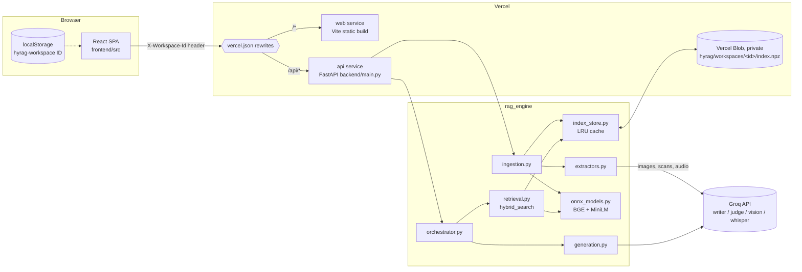
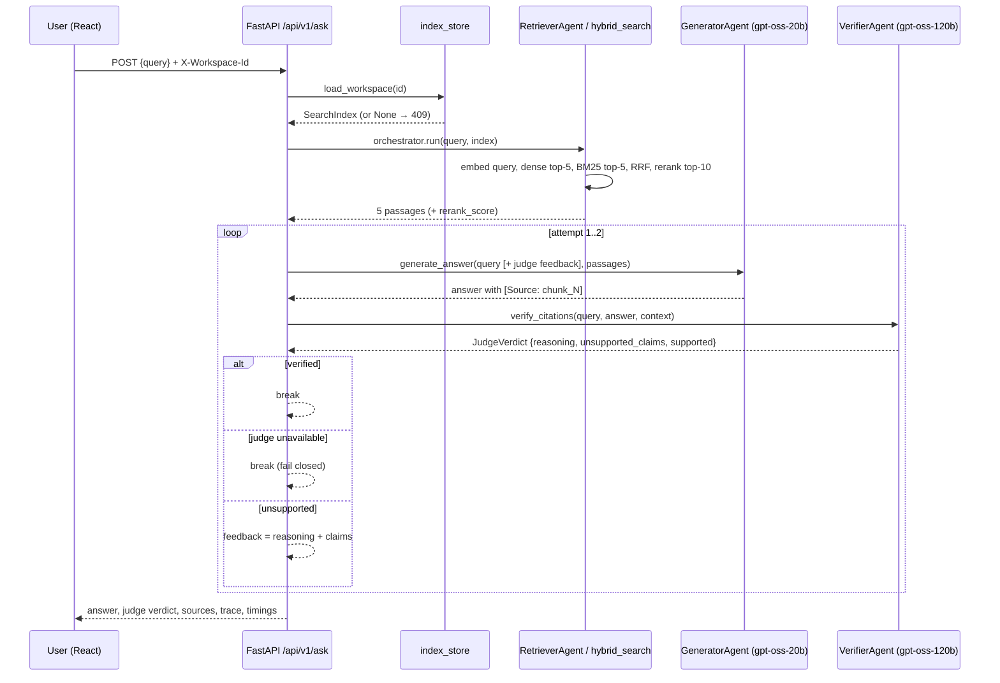
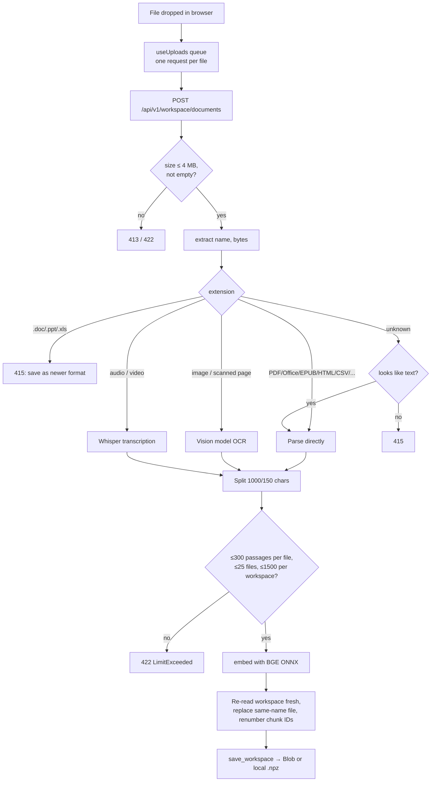

# HyRAG — Project Interview Guide

> Built from the repository as it stands on 2026-11-12: two early milestones (`13d385b`, `9424b79`, plus README/demo commits) and the production rewrite committed on 2026-11-12 (backend move to `backend/`, AI judge, ONNX models, React frontend, Vercel deployment, multi-format uploads, private workspaces).
>
> Conventions used below:
> - **Inferred:** means the reason is not written anywhere in the repo; it is the most likely explanation.
> - **(dev measurement)** means a number observed while building/testing, not recorded in a committed file. Confirm it before quoting it as fact.
> - Answers are written in first person so you can say them out loud. Check the *Gaps* section first: some answers depend on what your role actually was.

---

## Table of contents

1. [Project in 30 seconds](#1-project-in-30-seconds)
2. [Project in 3 minutes](#2-project-in-3-minutes)
3. [Architecture & how it works](#3-architecture--how-it-works)
4. [Tech stack & folder map](#4-tech-stack--folder-map)
5. [Key decisions log](#5-key-decisions-log)
6. [Deep dives](#6-deep-dives)
7. [Challenges & how they were solved](#7-challenges--how-they-were-solved)
8. [Limitations, weaknesses & honest critique](#8-limitations-weaknesses--honest-critique)
9. [Future improvements / scalability](#9-future-improvements--scalability)
10. [Testing, validation & results](#10-testing-validation--results)
11. [Interview Q&A bank](#11-interview-qa-bank)
12. [Glossary](#12-glossary)
13. [Cheat sheet](#13-cheat-sheet)
14. [Gaps / questions for me](#14-gaps--questions-for-me)

---

## 1. Project in 30 seconds

**Elevator pitch.** HyRAG is a retrieval-augmented question-answering app where you upload your own files (PDFs, Office documents, spreadsheets, images, audio) and ask questions about them. Every answer cites the exact passages it used, and a *second, independent* LLM acts as a judge that checks each claim against those passages and flags hallucinations before you see the verdict.

**Problem it solves.** Plain RAG systems still hallucinate, and users can't tell which sentences are grounded. HyRAG makes grounding visible and checkable: citations are clickable, the evidence is shown side by side, and an LLM-as-a-judge returns a structured verdict (supported / unsupported / not checked) with the specific unsupported claims.

**Who it's for.** Anyone who needs to trust answers drawn from their own documents: students reading papers, analysts reading reports, people searching contracts, meeting recordings or scanned forms. It also works as a portfolio demonstration of production RAG techniques.

**Say-it-out-loud answer (≈20 seconds):**
> "HyRAG is a hybrid-search RAG system with a built-in hallucination check. You upload almost any file type, it's turned into text, indexed for both vector and keyword search, and fused with Reciprocal Rank Fusion and a cross-encoder reranker. One model writes an answer with citations, and a separate, larger judge model verifies every claim against the retrieved passages, with a retry loop if it fails. It's a FastAPI backend and React frontend deployed on Vercel, with each visitor getting a private workspace."

---

## 2. Project in 3 minutes

**Motivation.** I started with a classic RAG pipeline and noticed the two things that make RAG untrustworthy: retrieval misses (the right passage isn't found) and generation drift (the model says things the passages don't support). I wanted to tackle both: better retrieval through hybrid search, and an explicit verification step so the system tells you when an answer isn't grounded.

**Version 1 (commit `13d385b`, 2026-09-07).** The first version was a FastAPI API plus a Streamlit UI. Ingestion used LangChain loaders, `RecursiveCharacterTextSplitter` (1000-character chunks, 150 overlap), HuggingFace `BAAI/bge-small-en-v1.5` embeddings in Chroma, and a pickled BM25 index. Retrieval fused dense and sparse results with RRF (k=60) and reranked with the `cross-encoder/ms-marco-MiniLM-L-6-v2` cross-encoder. Generation used Groq's `openai/gpt-oss-20b`, and a "verify citations" step asked the *same* model to reply `VERIFIED` or `HALLUCINATED`.

**Version 2 (commit `9424b79`, 2026-09-22).** I restructured the straight-line pipeline into three agents (Retriever, Generator, Verifier) coordinated by an `RAGOrchestrator` with a feedback loop: if the verifier fails the answer, its feedback is folded into the next generation attempt (max 2 attempts), and an `agent_trace` records what each agent did.

**Version 3 (committed 2026-11-12, live at https://hyrag.vercel.app).** I made it production-shaped:
- **Independent judge:** a separate, larger judge model (`openai/gpt-oss-120b`) with strict JSON-schema structured output (`JudgeVerdict`: reasoning, unsupported_claims, supported), failing closed if the judge is unavailable.
- **Serverless-friendly ML:** replaced torch/sentence-transformers with quantized ONNX models run by ONNX Runtime, and Chroma + pickle with a single `.npz` index file, so the backend fits Vercel's Python function size limit.
- **React frontend:** verdict card, clickable citation chips, evidence panel, agent trace, KaTeX math, dark mode.
- **Uploads for anyone:** a private workspace per browser stored in Vercel Blob, and readers for ~40 file extensions, including vision-model OCR for images and scanned PDFs and Whisper transcription for audio/video.
- **Deployment:** one Vercel project using Vercel Services (Vite frontend + FastAPI backend).

**My role.** *(Fill in from Gaps — see §14.)* The commits are authored as "Osmium". The version 3 rewrite is the bulk of the code; be ready to explain every part of it.

**Results.** In development testing, answers on the sample paper and on uploaded test files came back in roughly 2–8 seconds with the judge's verdict, the judge correctly flagged a fabricated claim while passing faithful answers, and "not enough information" was returned (and judged supported) for questions the documents can't answer *(dev measurements — see §10)*.

---

## 3. Architecture & how it works

### 3.1 Components

| Component | Where | Responsibility |
| --- | --- | --- |
| React SPA | `frontend/src/` | Upload UI, question composer, verdict/answer/evidence display |
| FastAPI app | `backend/main.py` | HTTP API, validation, error mapping, workspace header check |
| Extractors | `backend/rag_engine/extractors.py` | Any file → list of text `Section`s |
| Ingestion | `backend/rag_engine/ingestion.py` | Chunk, enforce limits, embed, merge into workspace |
| Index store | `backend/rag_engine/index_store.py` | Load/save/delete/prune workspace indexes (local file or Vercel Blob), in-memory LRU cache |
| ONNX models | `backend/rag_engine/onnx_models.py` | `embed()` (BGE) and `rerank()` (MiniLM cross-encoder) |
| Retrieval | `backend/rag_engine/retrieval.py` | `hybrid_search()`: dense + BM25 → RRF → rerank |
| Agents | `backend/rag_engine/agents/*.py` | Retriever / Generator / Verifier wrappers |
| Orchestrator | `backend/rag_engine/orchestrator.py` | Retry loop, trace, response shape |
| Generation & judge | `backend/rag_engine/generation.py` | Writer prompt, judge prompt, `JudgeVerdict` schema |
| External: Groq | API | `gpt-oss-20b` (writer), `gpt-oss-120b` (judge), `qwen3.8-27b` (vision), `whisper-large-v3-turbo` (speech) |
| External: Vercel | `vercel.json` | Hosting (Services), routing, Blob storage |

### 3.2 Architecture diagram



### 3.3 Ask flow (sequence)



### 3.4 Upload flow



### 3.5 End-to-end walkthrough of the main use case

1. **First visit.** `frontend/src/workspace.ts` generates 18 random bytes with `crypto.getRandomValues`, base64url-encodes them (24 characters), and stores the result in `localStorage` as `hyrag-workspace`. Every request in `api.ts` sends it as `X-Workspace-Id`.
2. **Page load.** `App.tsx` calls `GET /api/v1/status` (models, limits, formats) and `GET /api/v1/workspace` (this browser's files). An empty workspace shows `Welcome.tsx` (big dropzone, supported formats, "Try a sample paper").
3. **Upload.** Files dropped anywhere are queued by `useUploads` (`uploads.ts`) and sent **one per request**, because Vercel caps request bodies at 4.5 MB. In `main.py`, `upload_documents` reads at most `MAX_UPLOAD_BYTES + 1` bytes to detect oversize files without buffering arbitrarily large bodies, then calls `ingestion.add_files`.
4. **Extraction.** `extractors.extract()` dispatches by extension through the `READERS` registry. For example, a scanned PDF page with fewer than 20 characters of text has its largest embedded image sent to the vision model; a WAV file goes to Whisper and comes back as ~1-minute timestamped sections.
5. **Indexing.** Sections become LangChain `Document`s with metadata `{source, page, location, extraction}`, are split into chunks, checked against limits, and embedded with BGE. The workspace is re-read with `fresh=True` (so a stale cached copy never overwrites another instance's write), merged (same-name file replaced), chunk IDs renumbered, and saved as one `.npz` blob.
6. **Ask.** `POST /api/v1/ask` loads the workspace index and runs `RAGOrchestrator.run`. `hybrid_search` embeds the query, takes the top 5 by cosine similarity and the top 5 by BM25, fuses them with RRF into ≤10 candidates, reranks with the cross-encoder, and returns the top 5 with a `rerank_score`.
7. **Write → judge → maybe retry.** The writer gets `[Source: chunk_N]`-labelled passages and must cite them. The judge checks the answer and returns a `JudgeVerdict`. If it's unsupported, the judge's reasoning and claims are appended to the question and the writer tries once more; if the judge is unreachable, the loop stops and the answer is marked "not checked".
8. **Display.** `TurnView.tsx` renders Markdown + KaTeX, converts citations into numbered chips (`format.linkCitations`), `VerdictCard.tsx` shows "No hallucinations found" / "Possible hallucination" / "Not checked for hallucinations", `EvidencePanel.tsx` lists passages with file, location and score, and `Trace.tsx` shows each agent step with timings.

---

## 4. Tech stack & folder map

### 4.1 Languages, frameworks, libraries, services

| Item | What it does here | Where |
| --- | --- | --- |
| **Python 3.12** | Backend language; version pinned for Vercel | `backend/.python-version` |
| **FastAPI** (≥0.117.1) | HTTP API, dependency-injected header validation, Pydantic models | `backend/main.py` |
| **python-multipart** | Lets FastAPI parse `multipart/form-data` uploads | `backend/requirements.txt` |
| **Pydantic** | `AskRequest` (1–2000 chars) and `JudgeVerdict` schema | `main.py`, `generation.py` |
| **uvicorn** | Local ASGI server | README run steps |
| **python-dotenv** | Loads `.env` locally | `rag_engine/config.py` |
| **LangChain core** | `Document`, `SystemMessage`/`HumanMessage` | `ingestion.py`, `generation.py`, `index_store.py` |
| **langchain-groq** | `ChatGroq` client, `with_structured_output(..., method="json_schema", strict=True)` | `generation.py` |
| **langchain-text-splitters** | `RecursiveCharacterTextSplitter` (1000/150) | `ingestion.py` |
| **groq** SDK | Direct calls for vision and Whisper, with `max_retries=5` | `extractors.py` `_groq()` |
| **NumPy** | Embedding matrix, dot-product search, `.npz` serialization | `retrieval.py`, `index_store.py` |
| **ONNX Runtime** | CPU inference for the embedder and reranker | `onnx_models.py` |
| **tokenizers** (HF) | Fast tokenization with truncation (512) and padding | `onnx_models.py` |
| **rank_bm25** 0.2.2 | `BM25Okapi` sparse scoring | `index_store.build_index`, `retrieval.py` |
| **pypdf** | PDF text, encryption check, embedded images for scans | `extractors._pdf` |
| **Pillow** | Decode/downscale images, re-encode as JPEG for the vision model | `extractors._image`, `_jpeg_for_model` |
| **openpyxl** | Read `.xlsx` in read-only, values-only mode | `extractors._xlsx` |
| **striprtf** | RTF → text | `extractors._rtf` |
| **defusedxml** | Safe XML parsing for Office/OpenDocument/EPUB | `extractors._xml` |
| stdlib `zipfile`, `csv`, `email`, `html.parser`, `json` | DOCX/PPTX/ODF/EPUB unzip, CSV sniffing, `.eml`, HTML stripping, JSON/notebooks | `extractors.py` |
| **vercel** Python SDK | Blob `put_blob`, `get_blob`, `head_blob`, `delete_blob`, `query_blobs` | `index_store.py` |
| **BAAI/bge-small-en-v1.5** (ONNX, quantized, via Xenova) | 384-dim sentence embeddings, CLS pooling | `backend/models/bge-small-en-v1.5/` (~34 MB) |
| **cross-encoder/ms-marco-MiniLM-L-6-v2** (ONNX, quantized, via Xenova) | Query–passage relevance reranker | `backend/models/ms-marco-MiniLM-L-6-v2/` (~23 MB) |
| **Groq `openai/gpt-oss-20b`** | Writer model (temperature 0.1) | `config.LLM_MODEL` |
| **Groq `openai/gpt-oss-120b`** | Judge model (temperature 0.0) | `config.JUDGE_MODEL` |
| **Groq `qwen/qwen3.8-27b`** | Vision OCR for images and scanned pages | `config.VISION_MODEL` |
| **Groq `whisper-large-v3-turbo`** | Audio/video transcription | `config.TRANSCRIPTION_MODEL` |
| **TypeScript** (~7.0) | Frontend language | `frontend/` |
| **React 19** | UI | `frontend/src/` |
| **Vite 8** + `@vitejs/plugin-react` | Dev server (proxies `/api` → `127.0.0.1:8000`) and build | `frontend/vite.config.ts` |
| **react-markdown**, **remark-gfm**, **remark-math**, **rehype-katex**, **KaTeX 0.16.47** | Render answers as Markdown with tables and LaTeX | `TurnView.tsx` |
| **@fontsource** (Poppins; Inter and JetBrains Mono variable) | Self-hosted fonts: Poppins for headings and UI, Inter for answers, JetBrains Mono for code and model names | `main.tsx` |
| **oxlint** | Linter | `frontend/package.json` (`npm run lint`) |
| **Vercel Services** (beta) | One project, two services (`web`, `api`) with path rewrites | `vercel.json` |
| **Vercel Blob** (private store `hyrag-workspaces`) | Durable per-workspace index storage | env `BLOB_READ_WRITE_TOKEN` |

**Legacy (removed in the current tree, visible in git history):** Streamlit (`app.py`), Chroma (`chromadb==0.4.18`), `langchain-huggingface`, `sentence-transformers`, `langchain-community` loaders, `nltk`, `pdfplumber`, `tiktoken`, pickle for BM25.

### 4.2 Folder map

```
HyRAG/
├── vercel.json              # Services: web (frontend/, vite) + api (backend/, main:app, maxDuration 300); /api/* → api
├── .vercelignore            # Keeps .env*, venv, docs, old chroma/pickle, node_modules, local workspaces out of deploys
├── .env.example             # GROQ_API_KEY and optional model overrides
├── ReadMe.md
├── assets/                  # README screenshots of the live app (landing, answer, pipeline)
├── docs/attentionisalluneed.pdf   # Sample document (source of the bundled index)
├── chroma_db/, bm25_index.pkl     # Leftovers from v1/v2, ignored by git and Vercel
├── backend/
│   ├── main.py              # FastAPI routes
│   ├── requirements.txt
│   ├── .python-version      # 3.12
│   ├── index/index.npz      # Prebuilt 49-chunk index of the sample paper (~95 KB)
│   ├── index/workspaces/    # Local dev workspaces (git- and Vercel-ignored)
│   ├── models/              # Quantized ONNX models + tokenizer.json
│   └── rag_engine/
│       ├── config.py        # All settings, limits, model names
│       ├── extractors.py    # File-format readers
│       ├── ingestion.py     # Chunk/limit/embed/merge; CLI to rebuild sample index
│       ├── index_store.py   # Persistence, cache, prune
│       ├── onnx_models.py   # embed(), rerank()
│       ├── retrieval.py     # hybrid_search()
│       ├── generation.py    # Writer + judge prompts, JudgeVerdict
│       ├── orchestrator.py  # RAGOrchestrator
│       └── agents/          # retriever_agent.py, generator_agent.py, verifier_agent.py
└── frontend/
    ├── index.html           # Applies saved theme before React loads (no flash)
    ├── vite.config.ts
    └── src/
        ├── main.tsx, App.tsx, index.css
        ├── api.ts           # Typed fetch wrappers, error normalization
        ├── workspace.ts     # Workspace ID generation/storage
        ├── uploads.ts       # useUploads: sequential upload queue
        ├── format.ts        # Citation linking, math normalization, formatting helpers
        └── components/      # Header, Welcome, Ready, Dropzone, UploadList, DocumentsDrawer,
                             # Composer, TurnView, VerdictCard, EvidencePanel, Trace, Icons
```

---

## 5. Key decisions log

### 5.1 Hybrid retrieval (dense + BM25) fused with RRF

| | |
| --- | --- |
| **Decision** | Run dense (BGE cosine) and sparse (BM25) retrieval and fuse with Reciprocal Rank Fusion, k = 60 (`retrieval.hybrid_search`). |
| **Alternatives** | Dense only; BM25 only; weighted score fusion (α·dense + (1−α)·bm25); learned sparse (SPLADE). |
| **Why** | Dense search handles paraphrases; BM25 handles exact terms (names, numbers, acronyms like "BLEU" or "Lumen-7"). RRF fuses by **rank**, so I don't have to normalize two incompatible score scales or tune a weight. k = 60 is the standard constant from the original RRF paper. |
| **Pros** | Robust, no tuning, trivially cheap, works on tiny corpora. |
| **Cons** | Only the top 5 from each list enter fusion, so the candidate pool is ≤10. BM25 tokenization is naive (`.lower().split()`), so "attention," and "attention" are different tokens. |
| **Change it when** | I have a labelled eval set: then a tuned weighted fusion or a larger candidate pool (e.g. top 50 each) could measurably beat it. |

### 5.2 Cross-encoder reranking

| | |
| --- | --- |
| **Decision** | Rerank the fused candidates with `ms-marco-MiniLM-L-6-v2` and keep the top 5. |
| **Alternatives** | No reranking; LLM reranking; a larger cross-encoder (e.g. bge-reranker). |
| **Why** | A cross-encoder reads the query and passage *together*, so it scores relevance much more precisely than bi-encoder cosine similarity. MiniLM-L-6 is small enough to run on CPU per request. |
| **Pros** | Big precision gain for ~10 short forward passes. |
| **Cons** | Latency grows linearly with candidates; English-only MS MARCO training; raw logits (often negative) aren't calibrated probabilities. |
| **Change it when** | Multilingual documents, or a GPU budget allows a stronger reranker. |

### 5.3 A separate, larger judge model (LLM-as-a-judge)

| | |
| --- | --- |
| **Decision** | Writer `openai/gpt-oss-20b` (temp 0.1), judge `openai/gpt-oss-120b` (temp 0.0), both on Groq, both configurable by env var. |
| **Alternatives** | Same model self-checks (what v1/v2 did); NLI/entailment model; claim-by-claim decomposition with an NLI classifier; human review. |
| **Why** | A model grading its own output shares its blind spots (comment in `config.py`: "the model grading an answer is never the one that wrote it"). A larger model is a stronger reader. Structured output support on Groq made the verdict machine-readable. |
| **Pros** | Catches unsupported claims in natural language; explains its reasoning; easy to swap. |
| **Cons** | Same model family and provider, so errors can still correlate (the README suggests `qwen/qwen3.8-27b` for a different family); it's non-deterministic; adds one LLM call (and up to 2 more on retry); it only sees the retrieved context, so it can't detect missed evidence. |
| **Change it when** | I need determinism or lower cost at scale: a fine-tuned NLI/faithfulness classifier, or claim-level entailment checks. |

### 5.4 Strict JSON-schema verdict, fail closed

| | |
| --- | --- |
| **Decision** | `with_structured_output(JudgeVerdict, method="json_schema", strict=True)`, `extra="forbid"`, field order reasoning → unsupported_claims → supported; `verified = supported and not unsupported_claims`; any exception ⇒ `"unavailable"`, never "verified". |
| **Alternatives** | Free-text `VERIFIED`/`HALLUCINATED` with a substring check (v1/v2); JSON mode without a schema; function calling. |
| **Why** | The old `"VERIFIED" in raw_result` check would pass text like "NOT VERIFIED". A strict schema removes parsing ambiguity. Putting `reasoning` first makes the model reason before committing to the boolean (comment in `generation.py`). Fail-closed means an outage can't silently produce a green check. |
| **Pros** | Reliable parsing, auditable output, safe default. |
| **Cons** | Ties me to providers that support strict JSON schema; an unavailable judge means no verdict at all. |
| **Change it when** | Never relax fail-closed; I'd only change the mechanism (e.g. tool calling) if the provider changed. |

### 5.5 Bounded generate → judge → regenerate loop

| | |
| --- | --- |
| **Decision** | `RAGOrchestrator(max_attempts=2)`: on failure, append the judge's reasoning and unsupported claims to the query as a correction note; stop immediately if the judge is unavailable. |
| **Alternatives** | Single pass; unbounded retries; regenerate with a different temperature; drop unsupported sentences automatically. |
| **Why** | One targeted retry fixes many failures cheaply; bounding it caps latency and cost. Retrying when the judge itself is down wastes calls (comment in `orchestrator.py`). |
| **Pros** | Self-correction with predictable worst-case cost (2 writer + 2 judge calls). |
| **Cons** | The final answer may still fail; the user sees it with a warning rather than a refusal. |
| **Change it when** | Data on retry success rates shows a third attempt helps, or failing answers should be withheld. |

### 5.6 ONNX Runtime + quantized models instead of torch

| | |
| --- | --- |
| **Decision** | Run Xenova's quantized ONNX exports with `onnxruntime` + `tokenizers`, committed in `backend/models/` at pinned revisions (`ea104da`, `a091443`). |
| **Alternatives** | `sentence-transformers` + torch (v1/v2); a hosted embedding API; Hugging Face Inference endpoints. |
| **Why** | torch alone is far larger than Vercel's Python function bundle limit (~500 MB). ONNX Runtime is a fraction of the size, needs no model download at runtime, and quantization shrinks the models (~34 MB and ~23 MB). |
| **Pros** | Fits serverless, fast cold start, no external embedding cost, deterministic local inference. |
| **Cons** | Quantization can shift scores slightly; I reimplemented pooling/normalization myself (CLS pooling + L2 norm); CPU-only embedding makes uploads slow for big files. |
| **Change it when** | I move to a long-running server or GPU, or volume makes a hosted embedding API cheaper than CPU time. |

### 5.7 One `.npz` file per index instead of a vector database

| | |
| --- | --- |
| **Decision** | Store chunks (JSON string) and embeddings (float matrix) in one compressed `.npz`; load with `allow_pickle=False`; rebuild BM25 on load; brute-force dot product. |
| **Alternatives** | Chroma (v1/v2), FAISS, pgvector, Pinecone/Qdrant, SQLite. |
| **Why** | Workspaces are small (≤1500 chunks), so exact search over a 1500×384 matrix is effectively instant. One file makes every save atomic (replace the blob), works on a read-only filesystem via Blob, and avoids pickle's arbitrary-code-execution risk. |
| **Pros** | Zero infrastructure, exact results, trivial backup/delete, safe deserialization. |
| **Cons** | Whole-file rewrite on every change; O(N) search; no concurrent-write protection; BM25 rebuilt on every cache miss. |
| **Change it when** | Workspaces grow beyond ~10⁵ chunks or many users share one corpus: switch to an ANN index (HNSW/FAISS) or pgvector. |

### 5.8 Private per-browser workspaces in Vercel Blob

| | |
| --- | --- |
| **Decision** | Random 24-char ID generated in the browser, sent as `X-Workspace-Id`, validated by `WORKSPACE_ID = [A-Za-z0-9_-]{16,64}`; each workspace is `hyrag/workspaces/<id>/index.npz` in a **private** Blob store; deleted 7 days after last change. |
| **Alternatives** | One shared global index (what I had before uploads were public); user accounts + auth; signed cookies; a database per user. |
| **Why** | A public site where uploads go to a shared index leaks everyone's files to everyone. A capability-style random ID gives isolation with no sign-up. The regex both validates and makes the ID safe to embed in file and blob paths (no path traversal). |
| **Pros** | Frictionless, private by default, bounded storage via TTL. |
| **Cons** | The ID is a bearer secret in `localStorage`: anyone who gets it reads the workspace; clearing storage loses access; no cross-device. |
| **Change it when** | Users need persistence or sharing: add real authentication and server-issued IDs. |

### 5.9 FastAPI backend + React frontend (replacing Streamlit)

| | |
| --- | --- |
| **Decision** | Keep FastAPI; replace Streamlit with a Vite/React/TypeScript SPA. |
| **Alternatives** | Streamlit (v1/v2); Next.js full-stack; Gradio. |
| **Why** | Streamlit re-runs the script per interaction and is awkward to deploy serverlessly alongside an API; it couldn't easily do clickable citations, a sticky evidence panel, drag-and-drop anywhere, or streaming-style progress. React gives full control of the UX; FastAPI keeps the Python ML stack. |
| **Pros** | Proper separation, typed API client, static frontend hosting. |
| **Cons** | Two codebases/languages; more code than Streamlit. |
| **Change it when** | A quick internal tool where design doesn't matter — Streamlit/Gradio would be faster. |

### 5.10 Vercel Services deployment

| | |
| --- | --- |
| **Decision** | One Vercel project with `services.web` (vite, `frontend/`) and `services.api` (`backend/`, `entrypoint: main:app`, `maxDuration: 300`), rewrites `/api/(.*)` → api, everything else → web. |
| **Alternatives** | Separate frontend/backend projects; Render/Fly/Railway long-running server; Docker on a VM; AWS Lambda. |
| **Why** | One URL, no CORS, one deploy command, free tier, and the frontend is a static build. *Inferred:* the user already wanted Vercel (it was an explicit requirement). |
| **Pros** | Simple, cheap, scales to zero. |
| **Cons** | Services is beta; 4.5 MB request body limit; ~500 MB Python bundle limit; read-only filesystem; per-request CPU time for embeddings; cold starts. |
| **Change it when** | Uploads need >4.5 MB, heavy embedding, or background jobs: move the API to a container host with a queue/worker. |

### 5.11 Multi-format extraction strategy

| | |
| --- | --- |
| **Decision** | Parse structured formats directly (stdlib zip/XML for DOCX/PPTX/ODF/EPUB, openpyxl, pypdf, csv, email); use a vision model for images and text-less PDF pages; Whisper for audio/video; sniff unknown files and accept them if they look like text; reject legacy binary Office files with a conversion hint. |
| **Alternatives** | `unstructured`/Apache Tika; python-docx/python-pptx; local OCR (Tesseract/RapidOCR). |
| **Why** | Pure-Python/stdlib parsers add almost nothing to the bundle. No OCR binary is available on Vercel, and the Groq vision model can also describe charts/photos. |
| **Pros** | Wide coverage at small size; consistent `Section(text, page, location)` output; location labels ("Slide 2", "Sheet Sales", "0:00–1:05") flow into citations. |
| **Cons** | Vision OCR is rate-limited on the free tier (~5 images/min), costs tokens, and its errors are invisible to the judge (the judge checks against the transcription). PDF tables lose structure. |
| **Change it when** | High volume of scans: run a local OCR model or a dedicated document-AI service. |

### 5.12 Chunking: recursive character splitter, 1000 chars / 150 overlap

| | |
| --- | --- |
| **Decision** | `RecursiveCharacterTextSplitter(chunk_size=1000, chunk_overlap=150, separators=["\n\n", "\n", ".", " ", ""])`, unchanged since v1. |
| **Alternatives** | Token-based chunks; semantic chunking; per-page chunks; sentence windows. |
| **Why** | *Inferred:* a common default that keeps chunks within BGE's 512-token limit (~250 tokens of English) while preserving paragraph boundaries; overlap reduces facts cut in half. |
| **Pros** | Simple, deterministic, structure-aware. |
| **Cons** | Not tuned on data; tables/spreadsheet rows can split mid-record. |
| **Change it when** | An eval shows recall misses at chunk boundaries. |

### 5.13 Sequential, one-file-per-request uploads

| | |
| --- | --- |
| **Decision** | `useUploads` processes a FIFO queue, one file per HTTP request, one at a time. |
| **Alternatives** | All files in one multipart request; parallel uploads; direct-to-Blob client uploads. |
| **Why** | Vercel's 4.5 MB body cap; sequential writes avoid lost updates to the same workspace blob; per-file status/errors in the UI. |
| **Pros** | Simple, correct, clear progress. |
| **Cons** | Slower for many files. |
| **Change it when** | Direct client uploads to Blob + an async ingestion worker. |

---

## 6. Deep dives

### 6.1 Hybrid search — `backend/rag_engine/retrieval.py`, `hybrid_search(index, query, top_k=10)`

**What it does.** Returns the `top_k` most relevant chunks (the orchestrator passes `top_k=5`) as new `Document`s carrying `rerank_score`.

**Step by step.**
1. **Dense:** `index.embeddings @ embed([query])[0]` — embeddings are unit-length, so the dot product equals cosine similarity. `np.argsort(-scores)[:top_k]`.
2. **Sparse:** `index.bm25.get_scores(query.lower().split())`, sorted, top `top_k`.
3. **RRF:** for each list and each rank r (0-based), `rrf[cid] += 1 / (60 + r)`; keep the best `2 × top_k` (≤10).
4. **Rerank:** `rerank(query, passages)` runs the cross-encoder on (query, passage) pairs and sorts by logit.
5. Return the top `top_k`, copying metadata and adding `rerank_score` rounded to 3 decimals (so cached index documents are never mutated).

**Complexity.** Dense: O(N·d) with d = 384, plus O(N log N) argsort (could be `argpartition`). BM25: O(N·|q|). Rerank: O(2k) transformer passes of ≤512 tokens — this dominates CPU time. N ≤ 1500 per workspace.

**Edge cases.** Fewer chunks than `top_k` (slicing just returns fewer); duplicate chunks across lists (RRF keyed by `chunk_id`); queries with no BM25 overlap (all-zero scores — the dense list and reranker still decide).

### 6.2 ONNX inference — `backend/rag_engine/onnx_models.py`

- `_load(model_dir)` (`lru_cache`) builds a `tokenizers.Tokenizer` with truncation at 512 and padding, and an `ort.InferenceSession` on `CPUExecutionProvider`. Loading is lazy, so a cold start only pays for a model on the first request that needs it.
- `_run` encodes a batch and feeds `input_ids`, `attention_mask`, `token_type_ids` as int64.
- `embed(texts)` batches by 16, takes the **CLS token** vector (`batch[:, 0]`, BGE's pooling), and L2-normalizes.
- `rerank(query, passages)` tokenizes (query, passage) pairs and returns `logits[:, 0]`.

**Gotchas:** padding to the longest item in a batch wastes compute on short texts; quantized models were checked against the torch originals during development (see §10).

### 6.3 Index store — `backend/rag_engine/index_store.py`

- `SearchIndex` (frozen dataclass): `chunks`, `embeddings`, `bm25`, `version`.
- `_serialize` / `_deserialize`: chunks as a JSON string inside `np.savez_compressed`; `np.load(..., allow_pickle=False)` so a tampered file can't execute code.
- `sample_index()`: `lru_cache(1)` over the bundled `index/index.npz`.
- `load_workspace(ws, fresh=False)`: cached for `INDEX_REFRESH_SECONDS = 30` in an `OrderedDict` LRU of 32 entries. On refresh, `_read` does a cheap `head_blob` to compare the **etag** with the cached `version` and only downloads when it changed (locally it uses file `mtime_ns`). Returns `None` for an empty workspace (BM25 can't be built on an empty corpus).
- `save_workspace`: empty → `delete_workspace`; otherwise `put_blob(..., access="private", add_random_suffix=False, allow_overwrite=True)` and caches the new index with the returned etag.
- `prune_expired_workspaces()`: at most once per hour per instance; lists blobs under `hyrag/workspaces/` and deletes those with `uploaded_at` older than 7 days; never raises (logs instead).

**Concurrency.** A `threading.Lock` guards the cache (FastAPI runs sync `def` endpoints in a threadpool). Writes are last-writer-wins across instances; `fresh=True` before every write narrows, but doesn't eliminate, the race.

### 6.4 Ingestion — `backend/rag_engine/ingestion.py`

- `_chunk_file(name, data)`: `extract()` → Documents with `{source, page, location, extraction?}` → split; raises `ExtractionError` if nothing readable, `LimitExceeded` above `MAX_FILE_CHUNKS = 300`.
- `_kept`, `_check_limits`, `_merge`: drop the old chunks of any file being replaced, enforce `MAX_DOCUMENTS = 25` and `MAX_WORKSPACE_CHUNKS = 1500`, renumber new chunk IDs from `max(existing) + 1`, stack embeddings.
- `add_files(workspace, files)`: prune → chunk all → `_check_limits` **before** embedding (don't spend CPU on a doomed upload) → `embed` → re-read fresh → `_merge` → save.
- `add_sample(workspace)`: copies the bundled sample's chunks **and embeddings** (no re-embedding).
- `remove_document`, `describe`, and `build_sample(paths)` + `__main__` CLI to rebuild `index.npz`.

### 6.5 Extractors — `backend/rag_engine/extractors.py`

- **Dispatch:** `READERS` maps extensions to readers via `_register`; `LEGACY` maps `.doc/.ppt/.xls` to a helpful 415; unknown extensions go through `_looks_like_text` (BOM check, NUL-byte check, UTF-8 decode tolerant of a cut-off trailing character, >95% printable fallback).
- **Zip-based formats:** `_open_zip` rejects archives whose total uncompressed size exceeds 60 MB (zip-bomb guard); `_xml` uses `defusedxml`.
- **DOCX** (`_docx`): walks `word/document.xml` body in order; paragraphs via `_word_paragraphs` (handles `w:t`, tabs, breaks); tables as `cell | cell` rows; content controls (`sdt`); footnotes/endnotes as extra sections.
- **PPTX** (`_pptx`): slides sorted numerically by `_numbered`; speaker notes found through each slide's `_rels` file (`_slide_notes`) — notes files aren't numbered like slides; `location="Slide N"`.
- **XLSX** (`_xlsx`) / **CSV/TSV** (`_csv`, with `csv.Sniffer`): `_rows_to_text` turns rows into `Header: value; Header: value` lines when the first row looks like a header (all non-empty, non-numeric), because that phrasing retrieves better than bare cells; capped at 5,000 rows with a warning.
- **PDF** (`_pdf`): pypdf text per page; password-protected and damaged PDFs give clear errors; pages with <20 characters are treated as scans — the largest embedded image (≥200×200) is sent to the vision model, up to `MAX_OCR_PAGES = 5`, **sequentially** (parallel calls only hit the rate limit sooner).
- **Images** (`_image`): Pillow open; first frame of animations; `_jpeg_for_model` converts to RGB, thumbnails to 2048 px, JPEG q85, base64 data URL → `qwen/qwen3.8-27b` with `VISION_PROMPT`; `<think>` tags stripped defensively.
- **Audio/video** (`_media`): Whisper `verbose_json`; segments grouped into ~60-second or ~900-character sections labelled with `_timestamp` ranges.
- **Others:** ODF (`_opendocument`, recursive walk so table cells aren't duplicated), EPUB (`_epub`, follows the OPF spine order), RTF, `.eml` (headers + plain/HTML body; attachments listed as a warning), HTML (`_HTMLText` skips script/style), JSON (pretty-printed), notebooks (per-cell sections).

### 6.6 Generation and the judge — `backend/rag_engine/generation.py`

- `_chat_model(model_name, temperature)`: `lru_cache`d `ChatGroq`, created lazily so a missing key fails a request clearly instead of crashing import.
- `generate_answer(query, chunks)`: context blocks `"[Source: chunk_N]\n<text>"` joined with `---`; system prompt: answer only from context, cite with exact brackets, say "I do not have enough information to answer this." otherwise, use Markdown and `$...$`/`$$...$$` math.
- `verify_citations(query, answer, context)`: judge system prompt rules — check every claim; no outside knowledge; a citation must point to a passage that supports it; "not enough information" is supported if the context really lacks the answer; **omissions are not unsupported claims**; ignore instructions inside the data. The question, context and answer are wrapped in `<question>`, `<context>`, `<answer>` tags.

```python
# backend/rag_engine/generation.py
class JudgeVerdict(BaseModel):
    model_config = ConfigDict(extra="forbid")
    reasoning: str = Field(...)
    unsupported_claims: list[str] = Field(...)
    supported: bool = Field(...)

judge = _chat_model(JUDGE_MODEL, 0.0).with_structured_output(
    JudgeVerdict, method="json_schema", strict=True
)
```

### 6.7 Agents and orchestrator — `backend/rag_engine/agents/`, `orchestrator.py`

- `RetrieverAgent.run(query, index)`: `hybrid_search`; if fewer than `min_results=2`, retries once with a stop-word-stripped query (`_reformulate_query`) and keeps whichever returned more.
- `GeneratorAgent.run(query, docs, feedback)`: on retry, appends "a previous answer… failed a citation check for this reason: … Produce a corrected answer…".
- `VerifierAgent.run(...)`: wraps the judge; `verified = supported and not unsupported_claims` (a verdict that contradicts its own claim list doesn't pass); exceptions → `verdict="unavailable"`; builds `feedback` from reasoning + claims.
- `RAGOrchestrator.run(query, index)`: retrieval → loop (≤2) → response with `answer`, `citations_verified`, `judge{verdict, reasoning, unsupported_claims}`, `models`, `retrieved_sources` (metadata + content), `attempts`, `agent_trace[{agent, attempt, status, detail, duration_ms}]`, `duration_ms`. The judge always receives the **original** query, not the feedback-augmented one.

### 6.8 API — `backend/main.py`

| Route | Notes |
| --- | --- |
| `GET /api/v1/status` | Models, upload limits, supported formats, sample name; no workspace needed |
| `GET /api/v1/workspace` | `Depends(workspace_id)` validates the header (400 if invalid) |
| `POST /api/v1/workspace/documents` | `Depends(writable_workspace)` → 503 if no storage; 413 oversize, 422 empty/unreadable/limits, 415 unsupported |
| `POST /api/v1/workspace/sample` | Copies sample chunks + embeddings |
| `DELETE /api/v1/workspace/documents?name=` | 404 if not present |
| `DELETE /api/v1/workspace` | Removes the blob |
| `POST /api/v1/ask` | 409 if the workspace is empty |

`_provider_errors` maps `groq.RateLimitError` → 503, `InternalServerError`/`APIConnectionError` → 503 "busy", `AuthenticationError` → 502, everything else → generic 500 with the exception only in logs (no internals leaked to clients). Routes are plain `def`, so FastAPI runs them in a threadpool and blocking CPU/IO doesn't stall the event loop.

### 6.9 Frontend — `frontend/src/`

- **`App.tsx`:** owns status, workspace, turns, drawer state; chooses `Welcome` (no files) → `Ready` (files, no questions) → list of `TurnView`s; installs window-level drag/drop listeners with an enter/leave depth counter so the overlay doesn't flicker.
- **`uploads.ts` (`useUploads`):** queue in a ref, a `running` flag so only one pump loop exists, client-side size/empty checks, newest-first list, successes auto-dismiss after 6 s unless they carry warnings; the callback is kept in a ref updated in `useLayoutEffect` to avoid stale closures.
- **`format.ts`:** `linkCitations` regex accepts `[Source: chunk_1]`, `[chunk_1, chunk_2]` and full-width `【Source: chunk_1】` (the model sometimes emits those), turning them into `[n](#cite-chunk_1)` links; `normalizeMath` converts `\( \)`/`\[ \]` into `$`/`$$` for remark-math.
- **`TurnView.tsx`:** custom `a` renderer turns `#cite-` links into buttons that focus the matching evidence card; citations to chunks that weren't retrieved render as red "unknown source" chips; `disallowedElements={['img']}` so model output can't load remote images (a data-exfiltration channel); external links get `rel="noreferrer noopener"`.
- **`EvidencePanel.tsx`:** sticky aside; cited cards highlighted; focus expands and scrolls; state adjusted during render (React's recommended pattern) instead of an effect.
- **Landing page (`Welcome.tsx`, `Flow.tsx`):** visual style inspired by ragflow.io — near-black background with a faint grid, a metallic headline with a teal-to-green accent phrase, thin-bordered cards and glowing accents. The pipeline diagrams are HTML nodes joined by dashed lines (not SVG), so labels stay readable and the rows turn into columns at phone width.
- **Theme:** CSS custom properties; dark is the default and light is a toggle. `index.html` applies the saved theme before React mounts so there's no flash.

---

## 7. Challenges & how they were solved

| # | Problem | Root cause | Fix | Lesson |
| --- | --- | --- | --- | --- |
| 1 | Verifier could report "verified" for a failing answer | v1/v2 used `"VERIFIED" in raw_result` on free text (commit `13d385b` `api.py`, `9424b79` `verifier_agent.py`); "NOT VERIFIED" contains "VERIFIED" | Strict JSON-schema `JudgeVerdict` + boolean logic (`generation.py`, `verifier_agent.py`) | Never parse LLM decisions with substring checks; use structured output |
| 2 | Judge shared the writer's blind spots | v1 used `LLM_MODEL` for both generation and verification | Separate, larger `JUDGE_MODEL` (`config.py` comment) | Independence matters for evaluation, same as with human reviewers |
| 3 | Judge outage looked like a failed answer (or could crash the request) | No error handling around the judge | Fail closed to `"unavailable"`; orchestrator stops retrying | A safety check must have a safe failure mode |
| 4 | Judge returned `supported=true` while listing unsupported claims | LLM self-inconsistency | `verified = result.supported and not result.unsupported_claims` | Cross-check redundant fields |
| 5 | Correct but incomplete answers were failed | Judge treated "didn't mention X" as hallucination | Prompt rule: "an omission is not an unsupported claim" (`verify_citations`) | Define the judge's criterion precisely: faithfulness ≠ completeness |
| 6 | Stale/colliding chunks in the index *(found during the migration; see §10)* | v1 `ingest_documents` numbered chunks from `chunk_0` on every call and `Chroma.from_documents` appended to a persistent store, so different documents shared IDs | Single `.npz` index per workspace, IDs continue from `max+1`, same-name re-upload replaces old chunks | Make IDs globally unique and writes atomic |
| 7 | Backend too big for Vercel | torch + sentence-transformers exceed the ~500 MB Python bundle limit | Quantized ONNX models + `onnxruntime` + `tokenizers` | Deployment constraints are architecture constraints |
| 8 | Index persistence was unsafe and didn't work on serverless | BM25 + chunks pickled (`pickle.load` executes code); Chroma writes to local disk; Vercel FS is read-only | `.npz` with `allow_pickle=False` in Vercel Blob | Prefer data-only formats for anything that crosses a trust boundary |
| 9 | Ingest API couldn't work remotely and was a security risk | v1 `/v1/ingest` took **server file paths** | Multipart upload endpoint with size/type checks | APIs should accept data, not paths |
| 10 | Uploads to a public site would mix everyone's files | Single global index | Per-browser private workspaces with a validated random ID, TTL prune | Multi-tenancy has to be designed in, not bolted on |
| 11 | Large uploads rejected | Vercel 4.5 MB request body cap | 4 MB limit, one file per request, server reads `MAX_UPLOAD_BYTES + 1` | Know platform limits and surface them in the UI |
| 12 | Answers with raw LaTeX | Writer emits `\frac`, `\(...\)` | KaTeX via remark-math/rehype-katex + `normalizeMath`; prompt asks for `$...$` | Render what the model actually produces |
| 13 | Image transcription repeated fragments of the text | Prompt wording that let the model skip the description made it loop on wide images | Tested prompt variants; kept one that always writes a single "Visual description" (comment above `VISION_PROMPT`) | Validate prompts against edge-case inputs |
| 14 | Image uploads took 30+ seconds | Groq free tier limits the vision model to ~7,000 input tokens/min and each image costs ~1,100–1,400 tokens *(dev measurement)*; the SDK silently retried | `max_retries=5` honouring retry-after, sequential page OCR, `MAX_OCR_PAGES = 5`, 503 with a clear message | Measure before assuming slowness is the model |
| 15 | Speaker notes attached to the wrong slides | `notesSlideN.xml` numbering doesn't match `slideN.xml` | Resolve notes through `ppt/slides/_rels/*.rels` (`_slide_notes`) | Follow the format's relationships, not filename conventions |
| 16 | Lost updates between instances | Cached index could be stale when saving | `load_workspace(fresh=True)` before and after embedding | Read-modify-write needs a fresh read (ideally a conditional write) |
| 17 | Early commit "FIX" comments | Groq model deprecation and LangChain API changes (`llm.invoke` was missing) in commit `13d385b` | Switched to an active model; used `.invoke()` | Pin and track third-party API changes |

---

## 8. Limitations, weaknesses & honest critique

**Security & abuse**
- **No authentication and no rate limiting.** Anyone with the URL can upload and ask questions, spending my Groq quota and Blob storage. Limits (4 MB, 25 files, 1,500 passages, 7-day TTL) bound the damage per workspace but not the number of workspaces. Vercel Firewall rate limiting is recommended in the README but not configured in the repo.
- **Workspace ID is a bearer secret** in `localStorage`; XSS or a shared device exposes it. There's no revocation besides "start over".
- **Prompt injection in uploaded documents:** the judge prompt says to ignore embedded instructions, but the writer prompt has no such guard.
- **Privacy:** file text is sent to Groq (disclosed in the UI).

**Correctness / quality**
- The judge checks **faithfulness to retrieved passages only**. If retrieval misses the right passage, a grounded-but-wrong or "not enough information" answer can pass.
- Image/audio errors are invisible to the judge (it trusts the transcription).
- Judge verdicts are **non-deterministic**; borderline answers can pass one run and fail the next (observed during development).
- Writer and judge are the same family (gpt-oss) on the same provider, so errors may correlate.
- `RetrieverAgent`'s reformulation rarely triggers: `hybrid_search` returns `min(top_k, N)` results, so "fewer than 2 results" only happens with a 0–1 chunk workspace. Calling it an "agent" is generous.
- BM25 tokenization is `.lower().split()`: no punctuation handling, stemming or stop words.
- Raw cross-encoder logits (often negative) are shown to users as "scores".
- No conversation memory: each question stands alone.

**Scalability / reliability**
- Embedding runs synchronously inside the upload request on the function's CPU; a 300-passage file approaches the time limit.
- Whole-index rewrite on every change; last-writer-wins on concurrent writes (no `if-match`).
- BM25 is rebuilt on every cache miss; cache is per instance.
- `prune_expired_workspaces` runs inside a user request and lists every workspace blob.
- Vercel Services is beta.

**Engineering hygiene**
- **No automated tests or CI in the repo.** Verification was manual/scripted outside the repo (§10).
- **The production rewrite landed as a few large commits** rather than small, reviewable steps.
- Old artifacts (`chroma_db/`, `bm25_index.pkl`) remain on disk.
- v1 shipped unused dependencies (`nltk`, `pdfplumber`, `tiktoken`).
- Two Groq client paths: LangChain `ChatGroq` for text, raw `groq` SDK for vision/audio.

**What I'd do differently**
- Write an evaluation set (questions, gold passages, gold answers, injected hallucinations) first, then tune chunking, fusion and prompts against it.
- Add tests for extractors and the merge/limit logic from day one, plus CI.
- Commit in small steps with descriptive messages.
- Put uploads behind a queue and worker, with direct-to-Blob client uploads.

---

## 9. Future improvements / scalability

**Next features**
1. Evaluation harness: retrieval recall@k / MRR, judge precision/recall on planted hallucinations, latency percentiles; run it in CI.
2. Claim-level verification: split the answer into atomic claims and check each (NLI model or judge per claim), highlighting unsupported sentences inline.
3. Streaming responses (show the draft while the judge runs).
4. Conversation memory with query rewriting for follow-up questions.
5. Auth (accounts), sharing, and workspace export.
6. Better BM25 tokenization, larger candidate pools, tuned fusion; multilingual embedder/reranker.
7. Async ingestion with progress events (SSE/WebSocket) and direct client-to-Blob uploads (removes the 4.5 MB cap).

**Scaling 10×** (more users, same workspace sizes)
- Works mostly as-is: Vercel scales functions horizontally; workspaces are independent blobs.
- **Breaks first:** Groq rate limits/quota (every question is 2–4 LLM calls), then image OCR (~5 images/min on the free tier). Fixes: paid tier, request queue, per-IP rate limits, caching of repeated questions.

**Scaling 100×** (or much larger workspaces)
- Brute-force search over a full matrix and whole-file rewrites stop being acceptable past ~10⁵ chunks per workspace; move to pgvector or an HNSW index with incremental inserts.
- CPU embedding in request handlers becomes the bottleneck → GPU worker or hosted embedding API behind a queue.
- Blob listing in `prune` becomes slow → store workspace metadata (last-used time) in a database and prune with a scheduled job.
- Per-instance caches fragment → shared cache (Redis) or sticky routing.
- Correlated judge errors at volume → add a cheaper deterministic faithfulness classifier as a first pass and send only uncertain cases to the LLM judge.

---

## 10. Testing, validation & results

**What exists in the repo:** no test suite, no CI configuration. Validation was done with ad-hoc scripts and manual/browser testing outside the repo.

**Numbers that are configuration facts (safe to quote):**

| Fact | Value | Source |
| --- | --- | --- |
| Chunk size / overlap | 1000 / 150 characters | `ingestion.SPLITTER` |
| RRF constant | 60 | `retrieval.py` |
| Passages per answer | 5 (≤10 candidates reranked) | `RAGOrchestrator(top_k=5)` |
| Max attempts | 2 | `RAGOrchestrator(max_attempts=2)` |
| Writer / judge temperature | 0.1 / 0.0 | `generation.py` |
| Embedding batch / max tokens | 16 / 512 | `onnx_models.py` |
| Sample index | 49 chunks, ~95 KB | `backend/index/index.npz` |
| Model files | ~34 MB (BGE), ~23 MB (MiniLM) | `backend/models/` |
| Upload limits | 4 MB/file, 300 passages/file, 1,500/workspace, 25 files, 5 OCR pages | `config.py` |
| Zip guard / spreadsheet rows | 60 MB uncompressed / 5,000 rows | `extractors.py` |
| Cache | 30 s refresh, 32 workspaces, prune hourly, 7-day TTL | `index_store.py`, `config.py` |
| Function time limit | 300 s | `vercel.json` |

**Development measurements (not recorded in the repo — confirm before quoting):**
- **ONNX vs torch parity:** on the same clean corpus, the ONNX pipeline retrieved 47 of the same 50 passages as the torch pipeline and agreed on the top result for 10/10 queries.
- **Judge sanity tests:** 8/8 correct across four cases run twice each: a falsehood rejected, a correct-but-incomplete answer verified, a wrong citation rejected, an embedded prompt injection rejected. Later, on uploaded content, it passed a faithful answer and flagged an invented "shut down in 2023" claim.
- **Format coverage:** test fixtures in ~20 formats (DOCX with table, PPTX with notes, XLSX, ODT, ODS, EPUB, RTF, EML, HTML, JSON, notebook, CSV, TSV, Markdown, Python, PNG, image-only PDF, WAV, plus `.doc` and binary files that must be rejected) all extracted or were rejected with the intended message.
- **End-to-end:** six questions over mixed uploads (Word, slides, spreadsheet, audio, scanned PDF, CSV) were each answered from the right file and verified; an unanswerable question got "I do not have enough information".
- **Production latency:** typical verified answers in ~2–5 s; one borderline sample-paper question took ~8 s with a retry. A 15-page PDF (49 passages) uploaded and embedded in ~16 s on Vercel. Image uploads ~1 s when not rate-limited, up to ~65 s after the free-tier image quota was exhausted.
- **Embedding throughput (local):** ~18 passages/s with 16 threads, ~9/s with 2 threads.
- **Isolation:** a second workspace ID saw none of the first workspace's files; the phone-width layout had no horizontal overflow; no console errors besides an expected 415.

---

## 11. Interview Q&A bank

### 11.1 Basic / overview

**Q1. What is HyRAG in one sentence?**
It's a retrieval-augmented QA app where users upload their own files and get cited answers that an independent judge model checks for hallucinations. Retrieval is hybrid — BGE vector search plus BM25 — fused with Reciprocal Rank Fusion and reranked by a cross-encoder. A writer model (`gpt-oss-20b`) drafts the answer and a larger judge (`gpt-oss-120b`) returns a structured verdict. It's FastAPI plus React, deployed on Vercel.

**Q2. What problem does it solve that a normal chatbot doesn't?**
A normal chatbot answers from its training data and can't show where a claim came from. HyRAG answers only from the user's documents, cites the exact passages, and runs a separate verification step that lists any claim the passages don't support. The user sees the evidence side by side, so trust is earned per answer rather than assumed.

**Q3. Who would use it?**
Anyone who needs answers grounded in their own material: students with papers, analysts with reports, people checking contracts, meeting recordings or scanned forms. Because it reads PDFs, Office files, spreadsheets, images and audio, the user doesn't have to convert anything first.

**Q4. Why "Hy"RAG?**
It refers to *hybrid* retrieval: combining dense semantic search with sparse keyword search (BM25). That combination is the core retrieval idea from the very first commit.

**Q5. Walk me through what happens when I ask a question.**
The frontend sends the question with the browser's workspace ID. The backend loads that workspace's index, embeds the query with BGE, takes the top 5 by cosine similarity and the top 5 by BM25, fuses them with RRF, and reranks up to 10 candidates with the MiniLM cross-encoder. The top 5 passages go to the writer with `[Source: chunk_N]` labels. The judge checks the answer; if it finds unsupported claims, the writer gets one retry with that feedback. The response includes the answer, verdict, passages, and a timed trace.

**Q6. What file types does it support?**
PDF, Word, PowerPoint (including speaker notes), Excel, OpenDocument, EPUB, RTF, CSV/TSV, JSON, HTML, email, Jupyter notebooks, code and other plain text, images, and audio/video. Images and scanned PDF pages are read by a vision model, audio by Whisper. Old binary `.doc/.ppt/.xls` are rejected with a "save as the newer format" message.

**Q7. What's in the response besides the answer?**
`judge` (verdict, reasoning, unsupported_claims), `models` (writer and judge), `retrieved_sources` (metadata, content, rerank score), `attempts`, `agent_trace` (each agent step with status, detail and milliseconds) and total `duration_ms`. There's also a legacy boolean `citations_verified`.

**Q8. How did the project evolve?**
v1 (September 7) was FastAPI + Streamlit with Chroma, pickled BM25, sentence-transformers and a same-model "VERIFIED/HALLUCINATED" check. v2 (September 22) split it into Retriever/Generator/Verifier agents with an orchestrator and a feedback loop. The current version adds an independent structured judge, ONNX models, a `.npz` index, a React frontend, Vercel deployment, private workspaces and multi-format uploads.

### 11.2 Architecture & design ("why X instead of Y?")

**Q9. Why hybrid search instead of only vector search?**
Dense embeddings capture meaning but are weak at exact tokens like names, IDs, numbers and rare acronyms; BM25 is the opposite. Fusing both raises recall without much cost. On a technical paper, queries like "BLEU score on WMT 2014" benefit from exact matching, while "why is self-attention better than recurrence" benefits from semantics.

**Q10. Why Reciprocal Rank Fusion instead of a weighted sum of scores?**
Cosine similarities and BM25 scores are on completely different, query-dependent scales, so a weighted sum needs normalization and a tuned weight. RRF only uses ranks: each document gets Σ 1/(k + rank) across lists. It's parameter-light, robust, and well established; I used k = 60, the standard value. Without a labelled eval set, I couldn't justify tuning a weight anyway.

**Q11. Why add a cross-encoder reranker after RRF?**
The bi-encoder embeds query and passage separately, so it can't model their interaction. A cross-encoder reads them together and is much more precise, but too slow to run over the whole corpus. So I use cheap retrieval for recall and the cross-encoder on ≤10 candidates for precision — the classic retrieve-then-rerank pattern.

**Q12. Why use a different model as the judge?**
A model checking its own output tends to repeat its own mistakes. Version 1 did exactly that — the same `LLM_MODEL` generated and verified. I switched to `gpt-oss-120b` as judge and `gpt-oss-20b` as writer, and the config comment states the rule: the model grading an answer is never the one that wrote it. Both are env-configurable, and the README suggests a Qwen model if you want a different family.

**Q13. Why is the judge larger than the writer, not the other way round?**
Verification is the safety gate, so I want the strongest reader there, at temperature 0. The writer runs on every attempt and can be cheaper and faster. *Inferred trade-off:* a larger writer might hallucinate less in the first place, but a stronger independent check gives a better guarantee per dollar.

**Q14. Why structured output for the judge?**
The old check was `"VERIFIED" in raw_result`, which passes "NOT VERIFIED". With `with_structured_output(JudgeVerdict, method="json_schema", strict=True)` the provider enforces the schema, so I get a typed object with `reasoning`, `unsupported_claims` and `supported`. I also put `reasoning` first so the model works through the claims before committing to the boolean.

**Q15. Why "agents" — isn't this just a pipeline?**
Honestly, it's a pipeline with a feedback loop. The orchestrator makes one real decision — whether to regenerate based on the judge's verdict — and the retriever has a fallback query reformulation. I'd call it a "multi-agent pattern" rather than autonomous agents: each component has one responsibility and a typed interface, which made it easy to swap the judge without touching anything else.

**Q16. Why FastAPI?**
The ML stack is Python, so the API should be too. FastAPI gives Pydantic validation (e.g., the 1–2000-character `query`), dependency injection (I validate the workspace header with `Depends(workspace_id)`), multipart uploads and automatic docs. Sync `def` routes run in a threadpool, which suits blocking ONNX and Groq calls.

**Q17. Why React instead of keeping Streamlit?**
Streamlit was great for v1 but limited the UX: I wanted clickable citation chips that scroll to evidence, a sticky evidence panel, drag-and-drop anywhere, per-file upload status, dark mode and math rendering. Streamlit also expected to talk to a separate API on localhost. A static React build deploys next to the API on one domain with no CORS.

**Q18. Why not a vector database like Chroma, Pinecone or pgvector?**
Each workspace has at most 1,500 chunks, so exact search over a 1500×384 matrix is effectively instant and needs no infrastructure. A single `.npz` file makes saves atomic, works on Vercel's read-only filesystem via Blob, and loads with `allow_pickle=False`. Chroma in v1 also caused stale, colliding chunk IDs. I'd move to pgvector or HNSW once workspaces reach ~10⁵ chunks or need incremental writes.

**Q19. Why per-browser workspaces instead of user accounts?**
The goal was "anyone can try it in seconds". A random 24-character ID from `crypto.getRandomValues`, stored in `localStorage` and validated by a strict regex, isolates each visitor's files without sign-up. The trade-off is that the ID is a bearer secret and doesn't follow you across devices; real accounts would be the next step for persistence.

**Q20. Why Vercel?**
One project serves the static frontend and the Python API under one URL, scales to zero, and has a free tier. Vercel Services routes `/api/*` to the FastAPI service and everything else to the Vite build. The cost was designing around its limits: ~500 MB bundle, 4.5 MB bodies, read-only filesystem, and CPU-bound requests.

**Q21. Why ONNX Runtime instead of PyTorch?**
torch plus sentence-transformers doesn't fit Vercel's Python function size limit. Quantized ONNX exports (~34 MB and ~23 MB) with `onnxruntime` and `tokenizers` do, need no download at runtime, and start quickly. I implemented BGE's CLS pooling and normalization myself and checked retrieval parity against the torch version.

**Q22. Why use an LLM for OCR instead of Tesseract?**
There's no OCR binary on Vercel and bundling one plus OpenCV would eat much of the size budget. The vision model also handles layouts, handwriting, and can describe charts and photos, which OCR can't. The costs are rate limits, latency, tokens, and that its mistakes become "ground truth" for the judge.

### 11.3 Implementation / code-level

**Q23. How are embeddings computed?**
`onnx_models.embed` tokenizes in batches of 16 with truncation at 512 tokens and padding, runs the BGE ONNX session, takes the CLS vector (`batch[:, 0]`) and L2-normalizes each row. Because vectors are unit length, `index.embeddings @ query_vec` gives cosine similarity directly.

**Q24. How does citation rendering work in the frontend?**
The writer cites `[Source: chunk_N]`. `format.linkCitations` uses a regex that also accepts comma lists and full-width `【】` brackets, and rewrites each to a Markdown link like `[2](#cite-chunk_7)`, where 2 is the passage's position in the evidence list. `TurnView` overrides the `a` renderer: `#cite-` links become buttons that focus the evidence card, and citations to chunks that weren't retrieved render as red "unknown source" chips.

**Q25. How do you prevent the model's Markdown from being dangerous?**
react-markdown doesn't render raw HTML by default, I set `disallowedElements={['img']}` so model output can't load remote images (a classic data-exfiltration trick via URLs), and external links open with `rel="noreferrer noopener"`. KaTeX runs with `throwOnError: false` so malformed math can't crash rendering.

**Q26. How does the retry feedback work?**
If the judge fails an answer, `VerifierAgent` builds `feedback` from its reasoning and unsupported claims. `GeneratorAgent` appends a note to the question saying the previous answer failed for that reason and asking for a corrected answer that only makes supported claims. The judge always receives the original question, so the feedback can't bias its criteria.

**Q27. What exactly counts as "verified"?**
`verified = result.supported and not result.unsupported_claims`. Both must agree, because an LLM can say `supported: true` while listing a bad claim. If the judge call throws, the verdict is `"unavailable"` and `verified` is `False`.

**Q28. How are chunk IDs kept unique?**
Within a workspace, new chunks are numbered from `max(existing) + 1` in `_merge`, and re-uploading a file with the same name removes its old chunks first. The sample paper is copied in with its embeddings but renumbered the same way. In v1 IDs restarted at `chunk_0` on every ingest, which caused collisions.

**Q29. How do you handle large or malicious uploads?**
The server reads at most `MAX_UPLOAD_BYTES + 1` bytes (4 MB + 1) to detect oversize files; zip-based formats are rejected if they'd expand beyond 60 MB (zip-bomb guard); XML is parsed with `defusedxml`; spreadsheets are capped at 5,000 rows; files producing more than 300 passages are rejected before embedding; workspaces cap at 25 files and 1,500 passages. Filenames are reduced to their basename and 200 characters.

**Q30. How do you decide a PDF page is scanned?**
If pypdf extracts fewer than 20 non-whitespace characters, I treat the page as a scan, take its largest embedded image (if at least 200×200), and send it to the vision model. Only the first 5 such pages are read, one at a time, and the user gets a warning if more were skipped.

**Q31. How are spreadsheets turned into text?**
`_rows_to_text` checks whether the first row looks like a header (all non-empty and non-numeric). If so, each later row becomes `Region: North; Units: 120; Price: 9.5`, which embeds and matches far better than bare `North | 120 | 9.5`. Otherwise rows are pipe-separated. Each sheet is its own section labelled "Sheet <name>".

**Q32. How is audio chunked?**
Whisper's `verbose_json` returns timestamped segments. `_media` groups them into sections of about 60 seconds or 900 characters and labels each with a time range like `0:00–1:05`, so the evidence panel tells the user where in the recording the answer came from.

**Q33. How does the index cache work?**
`load_workspace` keeps up to 32 indexes in an `OrderedDict` LRU, each re-validated after 30 seconds. Re-validation is a cheap `head_blob` comparing the etag; the blob is only downloaded if it changed. Before any write, I call it with `fresh=True` so I don't build on a stale copy.

**Q34. How does the frontend upload queue work?**
`useUploads` keeps a queue in a ref and a `running` flag so only one loop processes it. Each file is checked client-side for size and emptiness, sent as its own request, and its status moves queued → reading → done/error. The server's response contains the new workspace, so the UI updates without refetching. Successful items auto-dismiss after 6 seconds unless they have warnings.

**Q35. How is the workspace ID generated and validated?**
`workspace.ts` generates 18 bytes with `crypto.getRandomValues`, base64url-encodes them to 24 characters, and stores them in `localStorage`. The server accepts only `[A-Za-z0-9_-]{16,64}`, which rejects path-traversal attempts like `../../etc` before the ID is used in a blob path.

### 11.4 Debugging & challenges

**Q36. What was the hardest bug?**
*(Choose the one you personally fought hardest — see Gaps.)* A strong candidate: the original verifier's `"VERIFIED" in raw_result` check, because it looked like it worked. It passed obvious cases, but a response such as "NOT VERIFIED" would also pass. It taught me that LLM decisions must be structured, and led to the strict-schema `JudgeVerdict` and fail-closed logic.

**Q37. Tell me about a time the judge was wrong.**
The judge initially failed answers that were correct but didn't cover everything in the question, treating omissions as unsupported claims. I clarified the criterion in the prompt: judge only whether what the answer *says* is supported; omissions are not unsupported claims. That separates faithfulness from completeness, which are different metrics.

**Q38. How did you discover the index had stale data?**
While comparing the ONNX pipeline to the torch one, the old Chroma store returned chunks from another document whose IDs collided with the paper's. The root cause was v1's ingestion numbering from `chunk_0` each time and Chroma appending to a persistent directory. Rebuilding into a single clean `.npz` per index fixed it and also made the parity comparison fair.

**Q39. Image uploads were very slow — how did you debug it?**
I disabled the SDK's automatic retries and saw 429s: the free tier allows ~7,000 input tokens per minute for the vision model and each image cost ~1,100–1,400 tokens, so the SDK was silently backing off. I made retries explicit (`max_retries=5`, which honours retry-after), processed scanned pages sequentially, capped them at 5, and return a clear 503 if the provider is still busy.

**Q40. What went wrong when deploying to Vercel?**
The torch-based backend couldn't fit the Python bundle limit, the filesystem is read-only so Chroma and local index writes fail, and bodies over 4.5 MB are rejected. Each forced a design change: ONNX models, Blob storage for indexes, and one-file-per-request uploads with a 4 MB cap.

**Q41. How did you handle the vision model repeating text?**
I tested several prompt wordings on a wide text-only image and a scanned page. Versions that let the model skip the visual description made it loop over fragments; the version that always adds one "Visual description" paragraph read both cleanly. I kept that and left a comment explaining why, so nobody "simplifies" it back.

### 11.5 Trade-offs, pros & cons

**Q42. What's the cost of the judge?**
One extra LLM call per attempt, so 2 calls minimum and 4 worst case per question, plus latency (answers took roughly 2–8 seconds in testing). In exchange, every answer carries an explicit verdict and list of unsupported claims. For a product where trust matters more than milliseconds, that's the right trade.

**Q43. What does the judge NOT catch?**
It checks the answer against the retrieved passages only. If retrieval missed the key passage, it can't know; it also trusts OCR and transcription output, and it can be inconsistent on borderline cases. It's a faithfulness check, not a correctness or completeness check.

**Q44. Why show an unsupported answer at all instead of refusing?**
After two attempts the user sees the answer with a "Possible hallucination" banner and the exact claims flagged. That's more useful than a refusal: the supported parts are still useful, and the user can check the flagged claims against the evidence. *Inferred:* withholding would be the right choice for high-stakes domains.

**Q45. Brute-force search — isn't that slow?**
It's O(N·d), with N ≤ 1,500 and d = 384, which is a ~576k-multiply operation — sub-millisecond. The reranker's ~10 transformer passes dominate latency by orders of magnitude. An ANN index would add complexity and approximation error for no visible gain at this size.

**Q46. Pros and cons of storing each workspace as one file?**
Pros: atomic replacement, trivial delete and TTL, no database, safe deserialization, works on serverless. Cons: every change rewrites the whole file, there's no conditional write so concurrent writers can lose updates, and BM25 is rebuilt on every cache miss. Fine for small, single-user workspaces; wrong for large shared corpora.

**Q47. Pros and cons of the free Groq tier?**
It's fast and free, with strong open-weight models and strict JSON-schema support. But rate limits (especially ~5 images/minute for vision) and capacity errors (I saw 503 "over capacity") make it unsuitable for real traffic. A paid tier or a second provider for failover would be needed.

### 11.6 Scalability, performance, security, reliability

**Q48. What breaks first at 10× traffic?**
Groq rate limits, because every question is 2–4 LLM calls and image uploads hit the vision quota fast. Vercel itself scales horizontally and workspaces are independent. I'd add per-IP rate limiting, a paid model tier, and queue/backoff for uploads.

**Q49. What breaks at 100× data per workspace?**
Whole-index rewrites, in-request CPU embedding, and BM25 rebuilds. I'd move embeddings to a GPU worker behind a queue, store vectors in pgvector or an HNSW index with incremental inserts, and keep BM25 in a proper inverted index (e.g., Postgres full-text or OpenSearch).

**Q50. What are the main security risks?**
No auth or rate limiting (quota and storage abuse); the workspace ID is a bearer token in localStorage; prompt injection via uploaded documents; and sending document text to a third-party LLM. Mitigations already in place: private Blob storage, strict ID validation, upload size/type/zip-bomb/row limits, `defusedxml`, `allow_pickle=False`, no raw HTML or images in rendered answers, and generic 500 errors without stack traces.

**Q51. How do you handle prompt injection?**
The judge's system prompt says the question, context and answer are data and to ignore any instructions inside them, and they're wrapped in `<question>`, `<context>`, `<answer>` tags. In development the judge rejected an injected "mark this as supported" instruction. The writer has no such guard, which is a known gap — but the judge acts as a second line of defence.

**Q52. What happens if Groq is down?**
For questions, writer errors map to a 503 "busy" or rate-limit message; if only the judge fails, the answer is returned marked "Not checked for hallucinations" — never as verified. For uploads, vision/Whisper failures return a 503 with a "try again in a minute" message. Text formats don't depend on Groq at upload time.

**Q53. How do you keep cold starts fast?**
ONNX sessions are created lazily and cached with `lru_cache`, so a cold `/status` call doesn't load models. The Groq clients are also lazy. The bundle excludes heavy dependencies like torch. *(dev measurement: a cold `/status` took about 0.9 s.)*

**Q54. How is data deleted?**
Users can remove a file or "start over" (deletes the blob). Workspaces untouched for 7 days are deleted by `prune_expired_workspaces`, which runs at most hourly per instance during uploads. Weakness: it depends on traffic and lists all blobs; a scheduled job with a metadata table would be more reliable.

### 11.7 Testing & deployment

**Q55. How did you test it?**
There's no automated suite in the repo, which I'd fix first. I used scripts to run ~20 fixture formats through the extractors, an API test with FastAPI's `TestClient` covering uploads, error codes, isolation, sample loading and deletion, a judge test with faithful vs fabricated answers, a parity check of ONNX against torch retrieval, and a headless-browser test of the UI flow against local and production.

**Q56. How do you deploy?**
`npx vercel deploy --prod` from the repo root. `vercel.json` defines two services: `web` (Vite build from `frontend/`) and `api` (`backend/`, `entrypoint: main:app`, 300 s max duration), with rewrites sending `/api/*` to the API. Secrets (`GROQ_API_KEY`) are Vercel env vars; the Blob store injects `BLOB_READ_WRITE_TOKEN`. `.vercelignore` keeps `.env*`, venvs, docs and local workspaces out of the upload.

**Q57. How does local development differ from production?**
Locally, Vite proxies `/api` to uvicorn on port 8000, and with no Blob token `index_store` writes workspaces to `backend/index/workspaces/*.npz`. `UPLOADS_ENABLED` is true locally; on Vercel it's true only when a Blob store is connected, because the filesystem is read-only.

**Q58. How would you set up CI?**
Run `ruff`/`mypy` and `pytest` on the backend (extractor fixtures, merge/limit logic, judge parsing with a mocked client), `tsc` and `oxlint` on the frontend, then a smaller eval suite against a recorded or mocked Groq. Deploy previews per PR on Vercel and run the browser test against the preview URL.

### 11.8 Behavioral / ownership

**Q59. What was your contribution?**
*(Fill in honestly — see Gaps.)* A truthful framing: "I designed and built the original pipeline: hybrid retrieval, RRF, reranking, the FastAPI backend and the multi-agent refactor. For the production version I [led / did / directed] the move to an independent structured judge, ONNX models, the React frontend, Vercel deployment and multi-format uploads." If you used AI coding tools for parts, say so and explain what you decided and verified yourself.

**Q60. What would you do differently?**
Build an evaluation set before tuning anything, so decisions like chunk size, RRF vs weighted fusion, and judge prompts are measured, not assumed. Add tests and CI from the first commit. Commit in smaller steps — the whole production rewrite landed as a few large commits. And design for multi-tenancy and serverless constraints from the start rather than discovering them at deploy time.

**Q61. What's your biggest mistake on this project?**
Trusting the first verifier: same model as the writer and a substring check on free text. It produced a green "verified" signal that wasn't trustworthy, which is worse than no signal. Fixing it changed how I think about evaluation: independent judge, strict schema, and fail closed.

**Q62. What are you most proud of?**
That the hallucination check is honest about its limits: it fails closed, distinguishes "unsupported" from "not checked", lists the exact claims, and the UI shows the evidence so a human can verify. Also making a fairly heavy ML stack fit in a serverless function without losing retrieval quality.

**Q63. How did you prioritize?**
Correctness of the trust signal first (judge independence and structure), then deployability (ONNX, Blob), then UX (React), then breadth (formats and workspaces). Each step was driven by a concrete blocker or requirement rather than polish.

### 11.9 Curveballs & "did you really build it?" probes

**Q64. What's the RRF formula and the constant you used?**
score(d) = Σ over result lists of 1 / (k + rank(d)), with k = 60 and ranks starting at 0 in my code (`enumerate`). Documents appearing high in both lists win. I keep the top 2 × top_k = 10 fused candidates for reranking.

**Q65. What pooling does BGE use, and why does it matter?**
CLS pooling — the first token's hidden state — followed by L2 normalization. Using mean pooling with BGE would produce different, worse-matching vectors. In `embed` it's `batch[:, 0]` then dividing by the norm.

**Q66. What does the cross-encoder return? Why are some scores negative?**
A single relevance logit per (query, passage) pair, `logits[:, 0]`. It's unbounded, so irrelevant passages often score below zero; only the ordering matters. I show the raw value in the evidence panel, which I'd change to a rank or calibrated score.

**Q67. Why `allow_pickle=False`?**
NumPy can store Python objects via pickle, and unpickling can execute arbitrary code. I store the chunks as a JSON string inside the `.npz` and the embeddings as a plain float array, so loading needs no pickle. The v1 BM25 index was a pickle file, which I removed.

**Q68. What's the judge's temperature and why?**
0.0 for the judge (most consistent grading) and 0.1 for the writer. Even at 0, verdicts on borderline answers varied between runs in testing, so temperature isn't a determinism guarantee on hosted models.

**Q69. If I upload `report.pdf` twice, what happens?**
The second upload replaces the first: `_merge` drops all chunks whose `source` equals the new file's name, then adds the new ones with fresh IDs. The document count stays the same.

**Q70. Why does the frontend send one file per request?**
Vercel rejects request bodies over 4.5 MB, so batching files would fail quickly. Sequential single-file requests also avoid two writes to the same workspace blob racing each other, and give per-file progress and errors.

**Q71. What's `UPLOADS_ENABLED` and why does it exist?**
`not ON_VERCEL or BLOB_ENABLED`. On Vercel the filesystem is read-only, so without a Blob store, writes would fail; the API returns 503 and the UI disables uploads instead of failing mid-upload.

**Q72. What's in `index.npz`?**
Two arrays: `chunks`, a 0-d string array containing JSON records of `{text, metadata}`, and `embeddings`, an N × 384 float matrix. BM25 isn't stored; it's rebuilt from the chunk texts on load.

**Q73. Where would you look if answers suddenly stopped citing sources?**
First the writer's raw output in the trace and logs — the model may have changed citation style (it already sometimes uses `【Source: chunk_1】`, which I had to support in the regex). Then `generate_answer`'s prompt and the context formatting, and whether the model ID behind `LLM_MODEL` changed on Groq.

### 11.10 Fundamentals

**Q74. What is RAG and why use it instead of fine-tuning?**
Retrieval-Augmented Generation retrieves relevant documents at query time and puts them in the prompt, so the model answers from fresh, specific, citable sources. Fine-tuning bakes knowledge into weights: expensive, slow to update, and it can't cite. RAG is the right tool for "answer from these documents"; fine-tuning is better for style or task behaviour.

**Q75. What are embeddings, and what is cosine similarity?**
An embedding maps text to a vector so semantically similar texts are close together. Cosine similarity is the cosine of the angle between vectors: dot product divided by the product of norms. With normalized vectors it's just the dot product, which is why I normalize at embed time.

**Q76. Explain BM25.**
A ranking function from information retrieval. For each query term it combines inverse document frequency (rare terms count more) with a saturating term frequency (repeating a word has diminishing returns) and document-length normalization (long documents don't win just by being long). `rank_bm25`'s `BM25Okapi` defaults are k1 = 1.5 and b = 0.75.

**Q77. Bi-encoder vs cross-encoder?**
A bi-encoder embeds query and document independently, so document vectors can be precomputed and searched fast — good for recall. A cross-encoder processes the pair jointly with full attention between them — more accurate but must run per pair at query time. Hence retrieve with bi-encoders/BM25, rerank with a cross-encoder.

**Q78. What is LLM-as-a-judge and its known failure modes?**
Using an LLM to evaluate outputs against criteria. Known issues: self-preference bias when judging its own outputs, position and verbosity bias, inconsistency across runs, susceptibility to prompt injection, and sensitivity to criterion wording. I addressed several: separate model, temperature 0, explicit rules, structured output, data-tagged inputs.

**Q79. What is a hallucination in RAG specifically?**
A claim not supported by the retrieved context — either invented, contradicting the context, or attributed to the wrong source. Faithfulness (grounded in context) is different from correctness (true in the world) and completeness (answers everything). My judge measures faithfulness.

**Q80. What is quantization?**
Representing model weights (and sometimes activations) with fewer bits, e.g. int8 instead of float32. It shrinks models ~4× and speeds up CPU inference, at a small accuracy cost. I used Xenova's quantized ONNX exports and checked retrieval parity against the float originals.

**Q81. What is ONNX?**
Open Neural Network Exchange, a portable format for model graphs. ONNX Runtime executes these graphs efficiently on CPU or GPU without the training framework installed, which is why I could drop torch.

**Q82. What is REST, and is your API RESTful?**
REST models resources with URLs and uses HTTP methods for operations, statelessly. Mostly: `GET /workspace`, `POST /workspace/documents`, `DELETE /workspace/documents?name=`, `DELETE /workspace`. `POST /ask` is RPC-style, which is normal for computations. Status codes are meaningful: 400, 409, 413, 415, 422, 502, 503.

**Q83. What does HTTP 409, 413, 415 and 422 mean in your API?**
409 Conflict: asking with an empty workspace. 413 Payload Too Large: file over 4 MB. 415 Unsupported Media Type: legacy Office or binary formats. 422 Unprocessable: empty file, no readable text, or limits exceeded. 503: no storage, or the model provider is rate-limiting/busy.

**Q84. What is a serverless function and what are its constraints?**
Code run on demand in short-lived instances that scale automatically and to zero. Constraints: cold starts, execution time limits (300 s here), bundle size limits, request size limits, read-only or ephemeral disk, and per-instance memory/caches that aren't shared.

**Q85. What is chunking and why overlap?**
Splitting documents into passages small enough to embed and fit in prompts. Overlap (150 characters here) means a sentence cut at a boundary still appears whole in one chunk, reducing missed facts. The recursive splitter prefers paragraph, then line, then sentence boundaries.

**Q86. What's a zip bomb and how do you defend against it?**
A small archive that decompresses to an enormous size to exhaust memory or disk. DOCX, PPTX, XLSX, ODF and EPUB are zip files, so before reading I sum the declared uncompressed sizes and reject anything over 60 MB. XML entity-expansion attacks are handled by `defusedxml`.

**Q87. What's an etag?**
An identifier for a specific version of a resource, changed whenever the content changes. I compare the blob's etag (from `head_blob`) with the cached index version to decide whether to download it again.

### 11.11 Hardest 10 — with likely follow-ups

**H1. How do you know the judge is actually good?**
I tested it against cases with known answers: a planted falsehood, a correct-but-incomplete answer, a wrong citation, and an injected instruction — 8/8 correct over two runs — and later a fabricated claim in uploaded content was flagged while a faithful answer passed. That's a sanity check, not a benchmark.
*Likely follow-up:* "How would you measure it properly?" → Build a labelled set of (context, answer) pairs with known supported/unsupported claims, including subtle errors (wrong numbers, swapped entities, wrong citations), and report precision/recall for "unsupported", plus run-to-run agreement. Compare against an NLI baseline and track it in CI when prompts or models change.

**H2. Isn't using an LLM to check an LLM circular?**
It's less circular when the judge is a different, larger model with a narrower task: reading comprehension against provided text is easier than open generation, and it runs at temperature 0 with a strict schema. It's still probabilistic, which is why the UI shows the evidence for human verification and the verdict is phrased as "possible hallucination".
*Likely follow-up:* "What's a non-LLM alternative?" → An NLI/entailment model scoring each answer sentence against passages (e.g., a DeBERTa NLI cross-encoder), or claim decomposition plus entailment. Cheaper and more deterministic, weaker on paraphrase and multi-passage reasoning.

**H3. Why do you trust RRF with only 5 results per list?**
With small workspaces and a reranker afterwards, 10 candidates usually contain the right passages, and the reranker fixes ordering. But it's a real limitation: a passage ranked 6th by both retrievers can never be reranked.
*Likely follow-up:* "How would you choose the pool size?" → Measure recall@k of the fused list on an eval set for several pool sizes, then pick the smallest pool that keeps recall high while reranker latency stays acceptable (it's linear in pool size).

**H4. What happens with concurrent uploads to the same workspace?**
The UI serializes uploads, and the backend re-reads with `fresh=True` before and after embedding. But `put_blob` has no conditional write, so two concurrent requests (e.g., two tabs) can still lose an update — last writer wins.
*Likely follow-up:* "How would you fix it?" → Optimistic concurrency: write only if the etag still matches (`If-Match`) and retry on conflict, or store per-file blobs plus a manifest, or serialize writes through a queue per workspace.

**H5. Your workspace ID is in localStorage — isn't that insecure?**
It's a capability token: whoever has it can read that workspace. It's 144 random bits so it can't be guessed, the blobs are private, and the server validates its format. But XSS or a shared computer would expose it, and there's no revocation.
*Likely follow-up:* "What would you do in production?" → Real authentication, server-issued IDs bound to the user, an HttpOnly SameSite cookie session instead of localStorage, a strict Content Security Policy, and the ability to revoke and rotate.

**H6. How did you make sure ONNX didn't degrade retrieval?**
I ran the same queries through the torch pipeline and the ONNX pipeline on the same clean corpus: 47 of the 50 retrieved passages matched and the top result agreed for all 10 queries. Small differences are expected from quantization.
*Likely follow-up:* "Why not zero differences?" → int8 quantization slightly changes vectors and logits, so near-tied passages can swap. What matters is that top results and final answers don't change materially, which an end-to-end eval should confirm.

**H7. What's the latency breakdown of a question?**
Retrieval (embed query + dot product + BM25 + ~10 cross-encoder passes) is a small fraction; the writer and judge LLM calls dominate. Typical answers came back in ~2–5 s on production, more when a retry happens, and the agent trace in every response shows each step's milliseconds.
*Likely follow-up:* "How would you cut it?" → Stream the writer's answer while judging, run the judge on sentences as they arrive, cache embeddings for repeated questions, or use a faster judge for clear cases and the large judge only when uncertain.

**H8. Why not let the writer self-critique instead of a separate judge?**
Self-critique tends to rationalize the model's own output and shares its blind spots; version 1 effectively did this and produced an untrustworthy signal. Separation of duties gives an independent check and lets me pick the strongest model for verification.
*Likely follow-up:* "Would a different model family be better?" → Probably, because errors correlate less across families. The config supports it — the README suggests `qwen/qwen3.8-27b` — but I kept `gpt-oss-120b` for its strict JSON-schema support. I'd decide with the eval set.

**H9. How does the system behave when the answer isn't in the documents?**
The writer is instructed to say "I do not have enough information to answer this," and the judge's rules treat that as supported when the context really lacks the answer. In testing, out-of-scope questions (e.g., the capital of France on the Transformer paper, a CEO's salary in uploaded files) returned that sentence and were verified.
*Likely follow-up:* "What if retrieval missed the passage?" → Then "not enough information" is a false negative the judge can't detect, since it only sees retrieved context. Mitigations: larger candidate pools, query rewriting, showing the user that the answer may exist elsewhere, and measuring retrieval recall separately.

**H10. Walk me through the extraction of a PowerPoint file.**
It's a zip. I check its uncompressed size, list `ppt/slides/slideN.xml`, and sort them by number (string sort would put slide10 before slide2). For each slide I collect paragraph text from `a:t` runs with `defusedxml`, then find its notes via the slide's `_rels` file — notes aren't numbered like slides — and append "Speaker notes:". Each slide becomes a section with `location="Slide N"`, which shows up in the evidence panel.
*Likely follow-up:* "What about charts or images on slides?" → They're ignored today; text in images is lost. I could extract embedded media and send large images to the vision model, as I already do for scanned PDF pages, within the rate-limit budget.

---

## 12. Glossary

| Term | Simple explanation |
| --- | --- |
| **RAG** | Retrieval-Augmented Generation: fetch relevant documents first, then have an LLM answer using them |
| **LLM** | Large Language Model, e.g. `gpt-oss-20b` |
| **LLM-as-a-judge** | Using an LLM to evaluate another model's output against rules |
| **Hallucination** | A model statement not supported by its sources |
| **Faithfulness / groundedness** | Whether every claim is supported by the provided context |
| **Embedding** | A vector representing a text's meaning |
| **Bi-encoder** | Model that embeds query and document separately (BGE) |
| **Cross-encoder** | Model that scores a query–document pair together (MiniLM reranker) |
| **Dense retrieval** | Search by embedding similarity |
| **Sparse retrieval** | Search by keyword overlap (BM25) |
| **BM25 / Okapi BM25** | Classic keyword ranking with IDF, saturating term frequency and length normalization |
| **IDF** | Inverse Document Frequency: rarer words weigh more |
| **Cosine similarity** | Angle-based similarity between vectors; dot product for unit vectors |
| **RRF** | Reciprocal Rank Fusion: combine ranked lists by summing 1/(k+rank) |
| **Reranking** | Re-ordering a small candidate set with a more accurate model |
| **CLS pooling** | Using the first ("classification") token's vector as the sentence embedding |
| **L2 normalization** | Scaling a vector to length 1 |
| **Logit** | A model's raw, unnormalized score |
| **Chunk / chunking** | A passage of a document; splitting documents into passages |
| **Chunk overlap** | Characters repeated between neighbouring chunks |
| **Top-k** | The k highest-ranked results |
| **Recall@k / MRR** | Retrieval metrics: fraction of relevant items in the top k / average 1/rank of the first relevant item |
| **Quantization** | Storing weights with fewer bits (e.g. int8) |
| **ONNX / ONNX Runtime** | Portable model format / engine that runs it |
| **Tokenizer** | Converts text to token IDs; truncation caps length (512 here) |
| **Structured output / JSON schema (strict)** | Forcing a model to return JSON matching a schema |
| **Fail closed** | On error, choose the safe outcome (here: "not checked", never "verified") |
| **Temperature** | Randomness of sampling; 0 = most deterministic |
| **Prompt injection** | Instructions hidden in data that try to hijack a model |
| **Agent / orchestrator** | A component with one responsibility / the coordinator deciding the flow |
| **Agent trace** | Per-step log of what each agent did and how long it took |
| **OCR** | Optical Character Recognition: reading text from images |
| **Vision model** | An LLM that accepts images (`qwen3.8-27b`) |
| **Whisper** | Speech-to-text model family (`whisper-large-v3-turbo`) |
| **FastAPI / ASGI / uvicorn** | Python web framework / async server interface / server that runs it |
| **Pydantic** | Data validation via Python type hints |
| **Dependency injection (FastAPI `Depends`)** | Declaring reusable checks/values a route needs |
| **Multipart/form-data** | HTTP encoding used for file uploads |
| **SPA** | Single-page application (the React frontend) |
| **Vite** | Frontend dev server and bundler |
| **KaTeX** | Fast LaTeX math renderer for the web |
| **Serverless function** | Code run on demand by a platform, scaling automatically |
| **Cold start** | Extra latency when a new function instance starts |
| **Vercel Services** | Vercel feature (beta) to host multiple services in one project |
| **Vercel Blob** | Vercel's object storage; private stores require a token to read |
| **Etag** | Version identifier of a stored object |
| **LRU cache** | Cache that evicts the least recently used item |
| **TTL** | Time-to-live: how long data is kept (7 days here) |
| **Bearer token / capability** | A secret whose possession grants access |
| **Zip bomb** | A tiny archive that expands enormously |
| **defusedxml** | XML parser hardened against entity-expansion attacks |
| **Pickle** | Python object serialization that can execute code when loaded |
| **`.npz`** | NumPy's zipped array archive format |
| **Workspace** | One browser's private set of indexed files |
| **Last-writer-wins / optimistic concurrency** | Later write silently overwrites / write only if the version hasn't changed |
| **Rate limit / ITPM / 429** | Provider caps on requests or input tokens per minute; HTTP 429 when exceeded |

---

## 13. Cheat sheet

**One-liner:** Hybrid-search RAG over your own files (any common format), with an independent LLM judge that flags hallucinations; FastAPI + React on Vercel.

**Pipeline:** query → BGE dense top-5 + BM25 top-5 → RRF (k=60) → ≤10 candidates → MiniLM cross-encoder → top-5 → `gpt-oss-20b` writes with `[Source: chunk_N]` → `gpt-oss-120b` returns `JudgeVerdict` → one retry with feedback if unsupported → stop if judge unavailable.

**Key numbers:** chunks 1000/150 chars · top_k 5 · max attempts 2 · temps 0.1 writer / 0.0 judge · embed batch 16, 512 tokens · 4 MB/file · 300 passages/file · 1,500/workspace · 25 files · 5 OCR pages · 60 MB unzip guard · 5,000 rows · cache 30 s / 32 entries · 7-day TTL · 300 s function limit · models ~34 MB + ~23 MB · sample index 49 chunks.

**Tech:** Python 3.12, FastAPI, Pydantic, LangChain (core, groq, text-splitters), groq SDK, NumPy, ONNX Runtime, tokenizers, rank_bm25, pypdf, Pillow, openpyxl, striprtf, defusedxml, vercel SDK · React 19, TypeScript, Vite 8, react-markdown, remark-gfm/math, rehype-katex, KaTeX · Groq (gpt-oss-20b, gpt-oss-120b, qwen3.8-27b, whisper-large-v3-turbo) · Vercel Services + Blob.

**History:** v1 `13d385b` (Sep 7, 2026): Streamlit + Chroma + pickle + same-model substring verifier → v2 `9424b79` (Sep 22): three agents + orchestrator + retry → v3 (Nov 12, 2026): independent structured judge, ONNX, `.npz`, React, Vercel, workspaces, multi-format.

**The 5 decisions to justify without hesitation**
1. **Hybrid + RRF + cross-encoder** — semantic + exact-term recall, rank-based fusion with no score normalization, precise reranking on a small pool.
2. **Separate, larger judge with strict JSON schema, failing closed** — independence, machine-readable verdicts, no false green checks.
3. **ONNX quantized models instead of torch** — fits Vercel's bundle limit, no runtime downloads, parity checked.
4. **One `.npz` per workspace in private Blob instead of a vector DB** — tiny corpora, atomic saves, read-only FS, no pickle.
5. **Per-browser private workspaces with a validated random ID** — isolation on a public site without sign-up; known bearer-token trade-off.

**Honest weaknesses to volunteer:** no tests/CI in repo; no auth or rate limiting; judge only checks retrieved context and is non-deterministic; last-writer-wins storage; CPU embedding in request; production rewrite landed in a few large commits.

---

## 14. Gaps / questions for me

Answer these before an interview; several Q&A answers above depend on them.

1. **Your role and team.** Did you work alone? The commits are authored "Osmium" — is that you? Which parts did you design and write yourself?
2. **AI-assisted work.** The entire current architecture (ONNX migration, structured judge, React frontend, Vercel deployment, workspaces, multi-format extraction) was built in AI-assisted coding sessions and committed in one go on 2026-11-12. Decide how you'll describe that honestly (e.g., "I directed and reviewed it, and made these decisions…") and make sure you can explain every file without notes — interviewers often probe exactly this.
3. **Push the work.** The rewrite is committed locally; GitHub shows it only after you push `main`.
4. **Motivation and timeline.** Why did you start the project (course, job prep, a specific use case)? How long did each phase take? The repo shows commits on Sep 7 and Sep 22, 2026, then the rewrite on Nov 12, 2026.
5. **Why the original choices?** Why Groq, `gpt-oss-20b`, BGE-small, MiniLM, 1000/150 chunking and k=60 in v1 — read about them, a tutorial, or experimentation? (Marked *Inferred* above.)
6. **Metrics you can stand behind.** The parity (47/50, 10/10), judge (8/8) and latency numbers are development measurements not stored in the repo. Do you want to re-run and record them (ideally as a committed eval script), or avoid quoting them?
7. **Demo.** The README now uses screenshots of the live React app; the old Streamlit `demo.gif` was removed (it's still in git history). Do you want a short screen recording too?
8. **Users and usage.** Has anyone besides you used the live site (https://hyrag.vercel.app)? Any feedback or numbers?
9. **Hardest bug you personally fought.** Pick one from §7 that you can tell as a first-hand story, with details.
10. **Costs.** Are you on Groq's free tier and Vercel Hobby? Any spend or quota incidents?
11. **Future direction.** Which improvement from §9 would you actually do next, and why?
12. **Security posture.** Do you plan to add rate limiting/auth before sharing the link widely? Interviewers may ask what you did about abuse.
