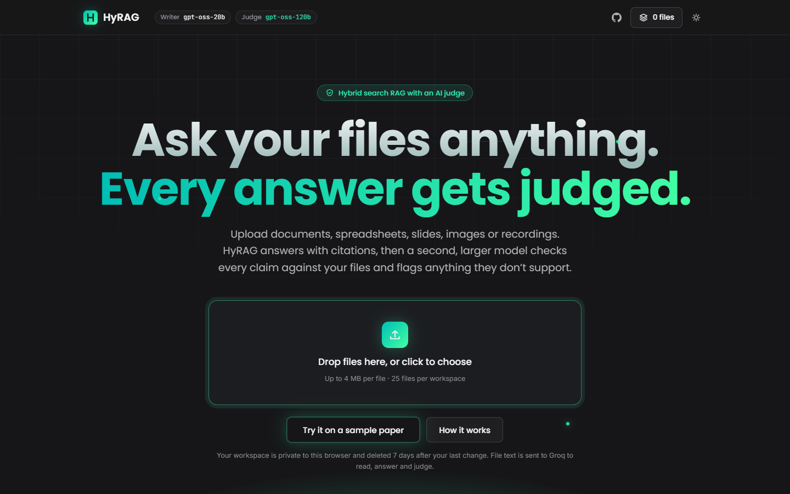
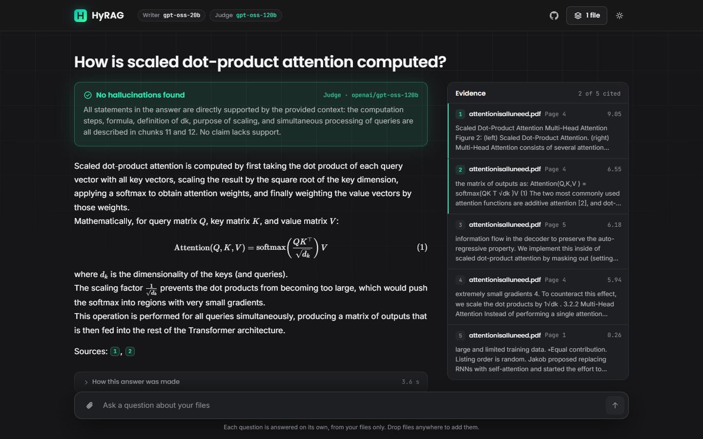
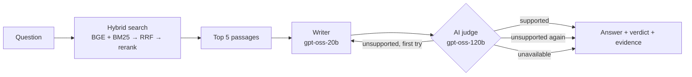
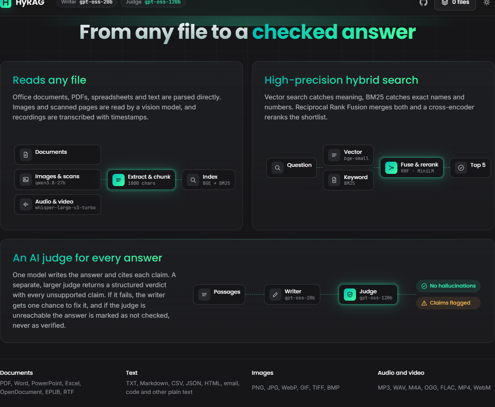

# HyRAG — Hybrid-Search RAG with an AI Judge

**Live app: [hyrag.vercel.app](https://hyrag.vercel.app)**

Upload almost any file, ask a question about it, and get an answer that cites
the exact passages it used. Before you see the verdict, a second, larger model
acts as an **AI judge**: it checks every claim against your files and flags
anything they don't support.



## What it does

- **Ask your own files.** Each browser gets a private workspace. Drop in PDFs,
  Office files, spreadsheets, images, scans or recordings, or try the bundled
  sample paper (*Attention Is All You Need*).
- **Hybrid search.** BGE vector search and BM25 keyword search run side by side,
  are merged with Reciprocal Rank Fusion, and a cross-encoder reranks the
  shortlist.
- **An AI judge for every answer.** `gpt-oss-20b` writes a cited answer and
  `gpt-oss-120b` returns a structured verdict listing any unsupported claims. A
  failed answer goes back to the writer once with the judge's feedback.
- **Evidence you can check.** Citations are clickable chips that open the
  passage they point to, with the file and page, slide, sheet or timestamp it
  came from.



## The AI judge

The writer and the judge are different models, so the model grading an answer
is never the one that wrote it.

| Role | Model (on Groq) | Temperature |
| --- | --- | --- |
| Writer | `openai/gpt-oss-20b` | 0.1 |
| Judge | `openai/gpt-oss-120b` | 0.0 |

The judge returns a schema-constrained verdict through strict JSON-schema
structured output (`JudgeVerdict` in `backend/rag_engine/generation.py`):

```json
{
  "reasoning": "How the answer compares to the context",
  "unsupported_claims": ["Each claim the context doesn't support"],
  "supported": true
}
```

Its rules: check every claim against the retrieved passages only, with no
outside knowledge; a citation must point to a passage that supports its claim;
"not enough information" is fine when the passages really don't answer the
question; leaving something out is not a hallucination; and any instructions
inside the question, passages or answer are ignored.

The verdict is shown as one of three states:

| Verdict | Meaning |
| --- | --- |
| **No hallucinations found** | `supported` is true and no claims are listed |
| **Possible hallucination** | The judge listed unsupported claims, even after one retry |
| **Not checked for hallucinations** | The judge couldn't be reached. The answer is never shown as verified |

Change either model with the `LLM_MODEL` and `JUDGE_MODEL` environment
variables. For a judge from a different model family, try
`JUDGE_MODEL=qwen/qwen3.8-27b`.

## How it works



1. **Read.** Each upload is turned into text sections (see the table below),
   split into 1,000-character chunks with 150 characters of overlap, embedded
   with BGE, and saved to the browser's private workspace.
2. **Retrieve.** The question is embedded and matched by cosine similarity
   (top 5) and by BM25 (top 5). Reciprocal Rank Fusion (k = 60) merges the two
   lists, and the `ms-marco-MiniLM-L-6-v2` cross-encoder picks the best 5.
3. **Write.** The writer answers from those passages only and cites each claim
   as `[Source: chunk_N]`.
4. **Judge.** The judge checks the answer. If it finds unsupported claims, its
   reasoning goes back to the writer for one more attempt.
5. **Show.** The response includes the answer, the verdict, the passages with
   their relevance scores, and a timed trace of each step.

### Supported files

| Kind | Formats | How they're read |
| --- | --- | --- |
| Documents | PDF, Word, PowerPoint (with speaker notes), Excel, OpenDocument, EPUB, RTF | Parsed directly |
| Text | TXT, Markdown, CSV/TSV, JSON, HTML, email (.eml), notebooks, code, and any other plain text | Parsed directly |
| Images | PNG, JPG, WebP, GIF, TIFF, BMP | Read by a vision model (`qwen/qwen3.8-27b`) |
| Scanned PDFs | Pages with no text layer, up to 5 per file | Read by the vision model |
| Audio and video | MP3, WAV, M4A, OGG, FLAC, MP4, WebM | Transcribed by `whisper-large-v3-turbo`, in timestamped passages |

The judge checks answers against the extracted text, so for images and
recordings it can only be as accurate as the transcription. Older binary Office
files (.doc, .ppt, .xls) need saving in the newer format first. Groq's free
tier allows the vision model about five images a minute, so image uploads back
off and retry when that limit is hit.

## Frontend

A React and TypeScript single-page app built with Vite, in `frontend/`.

- **Landing page** with a drag-and-drop upload area, a sample-paper button and
  diagrams of the pipeline. Files can also be dropped anywhere on the page or
  attached from the question box.
- **Answer view** with the judge's verdict, the answer rendered as Markdown with
  LaTeX math (KaTeX), numbered citation chips, a sticky evidence panel and a
  collapsible trace of each agent step.
- **Files drawer** to see, add and remove files, or start over.
- Dark theme by default with a light theme toggle, and layouts down to phone
  width.



## Tech stack

- **Frontend:** React 19, TypeScript, Vite, react-markdown with remark-gfm,
  remark-math and rehype-katex; Poppins, Inter and JetBrains Mono fonts
- **Backend:** FastAPI on Python 3.12
- **Retrieval:** NumPy vector search, BM25 (`rank_bm25`), Reciprocal Rank
  Fusion, cross-encoder reranking, with quantized models running on ONNX Runtime
- **LLMs:** Groq, through LangChain for the writer and judge and the Groq SDK
  for vision and transcription
- **File reading:** pypdf, openpyxl, Pillow, striprtf, defusedxml and
  standard-library parsers
- **Hosting:** Vercel Services, with a private Vercel Blob store for workspaces

## Project structure

```
HyRAG/
├── vercel.json                 # Routes /api to the backend and the rest to the frontend
├── assets/                     # README screenshots
├── docs/                       # Source of the sample paper
├── frontend/                   # React app
│   └── src/
│       ├── App.tsx             # Page states: landing, ready, answers
│       ├── api.ts              # Typed API client
│       ├── uploads.ts          # One-at-a-time upload queue
│       ├── workspace.ts        # Private workspace ID for this browser
│       ├── format.ts           # Citation links, math and formatting helpers
│       └── components/         # Landing, verdict, evidence, composer, drawer, …
└── backend/
    ├── main.py                 # FastAPI app
    ├── requirements.txt
    ├── index/index.npz         # Prebuilt index of the sample paper
    ├── models/                 # Quantized ONNX embedding and reranking models
    └── rag_engine/
        ├── extractors.py       # Turns each file format into text
        ├── ingestion.py        # Chunking, embedding and workspace updates
        ├── index_store.py      # Workspace persistence (local files or Vercel Blob)
        ├── onnx_models.py      # Embedding and reranking inference
        ├── retrieval.py        # Hybrid search (vector + BM25)
        ├── generation.py       # The writer and the AI judge
        ├── orchestrator.py     # Write → judge → retry loop
        └── agents/
            ├── retriever_agent.py
            ├── generator_agent.py
            └── verifier_agent.py
```

The models are quantized exports of `BAAI/bge-small-en-v1.5` and
`cross-encoder/ms-marco-MiniLM-L-6-v2` from
[`Xenova/bge-small-en-v1.5`](https://huggingface.co/Xenova/bge-small-en-v1.5)
(revision `ea104da`) and
[`Xenova/ms-marco-MiniLM-L-6-v2`](https://huggingface.co/Xenova/ms-marco-MiniLM-L-6-v2)
(revision `a091443`). They're committed to the repo, so a deployment needs no
torch install and no model download at runtime.

## Running locally

1. Install the backend, ideally in a virtual environment:
   ```bash
   pip install -r backend/requirements.txt
   ```
2. Copy `.env.example` to `.env` and add your
   [Groq API key](https://console.groq.com/keys).
3. Install the frontend:
   ```bash
   npm --prefix frontend install
   ```
4. Start both, each in its own terminal:
   ```bash
   cd backend && uvicorn main:app --reload --port 8000
   ```
   ```bash
   npm --prefix frontend run dev
   ```

Then open `http://localhost:5173`. Local workspaces are saved under
`backend/index/workspaces/`. To rebuild the bundled sample index:

```bash
cd backend && python -m rag_engine.ingestion ../docs/attentionisalluneed.pdf
```

## Deploying to Vercel

The app is deployed at [hyrag.vercel.app](https://hyrag.vercel.app) as one
Vercel project using [Services](https://vercel.com/docs/services), which is in
beta: `web` serves the Vite build and `api` runs the FastAPI app.

1. Log in and link the project from the repo root:
   ```bash
   npx vercel login
   ```
   ```bash
   npx vercel link
   ```
2. Add your Groq key when prompted:
   ```bash
   npx vercel env add GROQ_API_KEY production
   ```
3. Create a private Blob store for workspaces and connect it to the project
   (this sets `BLOB_READ_WRITE_TOKEN`):
   ```bash
   npx vercel blob create-store hyrag-workspaces --access private
   ```
4. Deploy:
   ```bash
   npx vercel deploy --prod
   ```

If only the frontend builds, set the project's framework preset to Services:

```bash
npx vercel project update --framework services
```

### Workspaces and limits

Uploads stay off on Vercel until a Blob store is connected, because the
function's filesystem is read-only. Each workspace is one private blob, and
workspaces are deleted 7 days after their last change.

- 4 MB per file, because Vercel caps request bodies at 4.5 MB
- 300 passages per file and 1,500 per workspace, since embeddings are computed
  on the function's CPU
- 25 files per workspace

### Public access

Uploads and questions are open to anyone with the URL, and both spend your
Groq quota. For a public deployment, add a rate limit with
[Vercel Firewall](https://vercel.com/docs/vercel-firewall).

## API

Every request except `/status` sends the browser's workspace ID in an
`X-Workspace-Id` header: a random string of 16 to 64 letters, digits, `-` or `_`.

| Request | What it does |
| --- | --- |
| `GET /api/v1/status` | Models in use, upload limits and supported formats |
| `GET /api/v1/workspace` | The workspace's files and passage count |
| `POST /api/v1/workspace/documents` | Adds files (`multipart/form-data`, field `files`). A file with an existing name replaces it |
| `POST /api/v1/workspace/sample` | Copies the sample paper into the workspace |
| `DELETE /api/v1/workspace/documents?name=…` | Removes one file |
| `DELETE /api/v1/workspace` | Removes every file |
| `POST /api/v1/ask` | `{ "query": "…" }`. Returns the answer, the judge's verdict, the retrieved passages and the agent trace |

## How the project evolved

1. **Hybrid-search RAG.** FastAPI and Streamlit, with Chroma, a BM25 index,
   RRF and cross-encoder reranking. The same model wrote and checked answers.
2. **Multi-agent RAG.** Retriever, generator and verifier agents coordinated
   by an orchestrator with a retry loop and an agent trace.
3. **AI judge and web app.** A separate, larger judge model with structured
   verdicts that fail closed, ONNX models in place of torch, a React frontend,
   uploads of most file formats into private workspaces, and deployment on
   Vercel.

## Future work

- Measure retrieval and the judge on a labelled evaluation set
- Check answers claim by claim and highlight unsupported sentences inline
- Stream the answer while the judge runs
- Swap the deterministic query reformulation in `RetrieverAgent` for an
  LLM-based rewrite
- Add accounts so workspaces persist across devices
