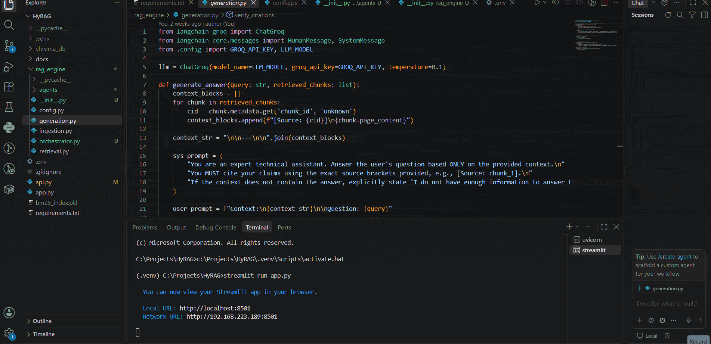

# HyRAG — Hybrid Search RAG Pipeline

A production-style Retrieval-Augmented Generation system combining dense
(vector) and sparse (BM25) retrieval, with a multi-agent generation
pipeline that verifies its own answers against source citations before
returning them.

## Demo



## Overview

HyRAG ingests documents, indexes them with both a vector store and a BM25
sparse index, and answers queries by combining the two retrieval signals
before generating a response. Rather than a single straight-line
retrieve → generate pipeline, answer generation is handled by three
cooperating agents that can retry and self-correct before returning a
result to the user.

## Architecture

```
                     ┌─────────────────┐
   query ──────────▶ │ RetrieverAgent   │
                     │ (hybrid search:  │
                     │  vector + BM25)  │
                     └────────┬─────────┘
                              │ documents
                              ▼
                     ┌─────────────────┐
              ┌─────▶│ GeneratorAgent   │
              │      │ (drafts answer)  │
              │      └────────┬─────────┘
              │               │ answer + context
   feedback   │               ▼
   on failure │      ┌─────────────────┐
              └──────│ VerifierAgent    │
                     │ (checks citations│
                     │  against context)│
                     └────────┬─────────┘
                              │ verified answer
                              ▼
                         API response
```

- **RetrieverAgent** — runs the hybrid search (dense vector + BM25). If
  the first pass returns too few results, it reformulates the query once
  and retries before falling back to whatever it found.
- **GeneratorAgent** — drafts an answer from the retrieved context. On a
  retry, it receives the verifier's feedback and is prompted to correct
  the specific issue rather than regenerating blindly.
- **VerifierAgent** — checks the generated answer's claims against the
  retrieved context and flags unsupported citations. On failure, its
  feedback is fed back into the GeneratorAgent for a bounded number of
  retries (default: 2 attempts total).
- **Orchestrator** (`rag_engine/orchestrator.py`) — coordinates the loop
  above and returns the final answer along with an `agent_trace` showing
  what each agent did, so the process is inspectable rather than a black
  box.

## Features

- Hybrid retrieval combining dense vector search (Chroma) and sparse
  keyword search (BM25) for more robust recall than either alone
- Multi-agent generation with an automatic retry/feedback loop when
  citation verification fails
- FastAPI backend exposing ingestion and query endpoints
- Streamlit frontend for document ingestion and interactive querying

## Tech Stack

- **Backend:** FastAPI, Python
- **Retrieval:** ChromaDB (vector store), BM25 (sparse/keyword index)
- **Frontend:** Streamlit
- **LLM orchestration:** custom multi-agent pipeline (see Architecture)

## Project Structure

```
HyRAG/
├── api.py                      # FastAPI backend — routes requests through the Orchestrator
├── app.py                      # Streamlit frontend
├── requirements.txt
├── docs/                       # Source documents for ingestion
├── chroma_db/                  # Persisted vector store
├── bm25_index.pkl              # Persisted BM25 sparse index
└── rag_engine/
    ├── ingestion.py            # Document loading and indexing
    ├── retrieval.py            # Hybrid search (vector + BM25)
    ├── generation.py           # Answer generation and citation verification
    ├── orchestrator.py         # Coordinates the multi-agent pipeline
    └── agents/
        ├── retriever_agent.py
        ├── generator_agent.py
        └── verifier_agent.py
```

## Setup

1. Clone the repo and create a virtual environment:
   ```bash
   git clone https://github.com/Osmium-hacked/hybrid-search-rag-pipeline.git
   cd hybrid-search-rag-pipeline
   python -m venv .venv
   .venv\Scripts\activate   # Windows
   ```
2. Install dependencies:
   ```bash
   pip install -r requirements.txt
   ```
3. Add required API keys to a `.env` file in the project root (e.g. your
   LLM provider key).

## Running the App

You need two processes running at the same time:

```bash
# Terminal 1 — backend API
uvicorn api:app --reload --port 8000

# Terminal 2 — frontend
streamlit run app.py
```

Then open `http://localhost:8501` and use the sidebar to ingest a
document before querying it.

## API

**Ingest documents**
```
POST /v1/ingest
{ "file_paths": ["./docs/sample.pdf"] }
```

**Ask a question**
```
POST /v1/ask
{ "query": "What does the document say about X?" }
```
Response includes the answer, whether citations were verified, the
retrieved sources, and the agent trace for that request.

## Future Work

- Swap the deterministic query reformulation in `RetrieverAgent` for an
  LLM-based rewrite
- Add evaluation metrics (retrieval precision/recall, answer faithfulness)
  tracked over a fixed test set
- Persist `agent_trace` logs for later analysis of retry frequency